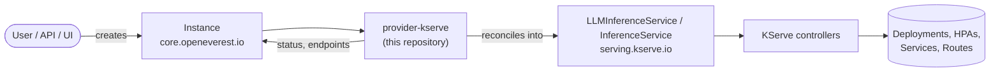

# Terms: OpenEverest, provider-kserve and KServe, in plain words

Read this once before the talk, and once more in the hallway. Every name you say on stage, or that someone can ask about, is here with a one-line meaning. The source is the provider-kserve README (v0.5.x), the provider-sdk docs, and the workshop manifests in this repo.

## The one-minute version

- **OpenEverest** is an open source platform that runs databases, and now models, on Kubernetes. You create one object. The platform does the rest.
- **Instance** is that one object. It says what you want: this model, one GPU, one replica. It does not say how.
- **Provider** is the piece that knows how. One provider per technology: PostgreSQL, MySQL, Valkey, and KServe. The provider turns an Instance into the objects of the real operator.
- **provider-kserve** is the provider for models. It turns an Instance into KServe objects. It never touches a Pod.
- **KServe** is the Kubernetes operator that serves models. Its controllers build the Deployments, the autoscalers, the Services and the routes.
- **vLLM** is the engine inside the model Pod. It loads the weights and answers the prompts.

The user, the API and the UI only see the Instance. The provider holds the technology knowledge. KServe and Kubernetes do the work.

## The picture

What each arrow means:

1. **User creates an Instance.** From the OpenEverest UI, the API, or `kubectl apply`. The Instance names the provider in `spec.providerRef.name: provider-kserve`.
2. **provider-kserve picks it up.** It watches every Instance that names it. It checks the parameters against its schema.
3. **It writes a KServe object.** For the `llm` topology, an `LLMInferenceService`. For the `predictor` topology, an `InferenceService`. The provider only translates. It does not run anything.
4. **The KServe controllers reconcile that object.** They create and keep the real workload: Deployments, HPAs, Services, routes.
5. **Kubernetes runs it.** Pods on GPU nodes, images pulled, DNS names, load balancers.
6. **Status comes back.** The provider reads the health of the KServe objects and writes it onto `Instance.status`, with the endpoint and the credentials. The UI shows Ready and a URL.

The controllers are never in the request path. A chat request goes from the client to the gateway to the Pod. The controllers only keep the cluster equal to what the Instance asks for.

## Who does what

| Layer | Owns | Never does |
|---|---|---|
| User, UI, API | The Instance: what you want | Anything technology specific |
| OpenEverest core | The Instance and Provider CRDs, the controller, the UI, the API, plugins | Model serving itself |
| provider-kserve | The translation: Instance to KServe objects, gateway wiring, status back | Managing Pods |
| KServe controllers | The workload: Deployments, autoscalers, Services, routes, model download | Reading the Instance |
| Kubernetes | Scheduling, images, networking, DNS | Knowing what a model is |

## What the provider builds, and what it hands to KServe

The provider "translates". KServe "reconciles". This table is the line between them.

| provider-kserve builds | KServe controllers build | Kubernetes does |
|---|---|---|
| `LLMInferenceService` (llm) or `InferenceService` (predictor), from the Instance | `Deployment`, or a `LeaderWorkerSet` for multi-node models | Schedules Pods on GPU nodes |
| `LLMInferenceServiceConfig` named `<instance>-config`, when you give inline config | `HorizontalPodAutoscaler`, or KEDA objects, for scaling | Pulls images, including OCI model images |
| `AIGatewayRoute`: matches the `model` field of the request and routes to the InferencePool | `Service` `<instance>-kserve-workload-svc` on port 8000 | Cluster DNS and ClusterIP addresses |
| API key `Secret` `<instance>-ai-gateway-key`, one random key per Instance | `InferencePool` and the endpoint picker, when gateway routing is on | LoadBalancer address from the cloud or MetalLB |
| `BackendTrafficPolicy` for the token quota, when a Valkey or Redis backend is set | Storage initializer: the init container that downloads `hf://` or `s3://` weights | Image garbage collection |
| `Service` `<instance>-external`, for `LoadBalancer` or `NodePort` access | Admission webhooks that validate the KServe objects | |
| `ServiceAccount` `<instance>-model-puller`, so a gated model can use the Hugging Face token | `ServingRuntime` selection for predictors, by model format | |
| `PodMonitor`, so Prometheus scrapes vLLM metrics | Rollouts, one Pod at a time on GPUs | |
| `Instance.status` and `status.connection`: URL, key ID as username, key as password, model name | | |

Two rules that follow from this:

- The provider never manages Pods. If a Pod is wrong, the fix is in KServe or in the Instance parameters, not in the provider loop.
- Everything runs in KServe **Standard** mode: plain Deployments plus HPA, no Knative, no Istio. KServe used to call this mode `RawDeployment`. There is no scale to zero in this mode. The minimum is one replica.

## The provider SDK

**provider-sdk** is the Go library every OpenEverest provider is built on. It defines the contract, so the core, the API and the UI can talk to any provider the same way.

A provider implements four calls:

| Call | When it runs | What provider-kserve does in it |
|---|---|---|
| `Validate` | Before anything is written | Checks the Instance parameters against the schema. Rejects a missing `modelURI`, a wrong `topology.type`, a `minReplicas` of zero |
| `Sync` | On every change to the Instance | Writes or updates the KServe objects and the gateway objects |
| `Status` | On every reconcile | Reads the KServe conditions and writes `Instance.status`, with the connection details |
| `Cleanup` | When the Instance is deleted | Removes what the owner references do not remove by themselves, such as the gateway key |

The SDK also gives the provider:

- **RBAC markers** in the Go code, which generate the `ClusterRole` it needs.
- **Watches** on the objects it creates, so a change in a KServe object wakes the provider.
- **Code generation** for the `Provider` resource: `make generate` reads `definition/` and writes the schemas the UI shows.

The **Provider** resource is how a provider registers itself. `kubectl get providers.core.openeverest.io provider-kserve` shows it. It carries the topologies, the versions, the parameter schemas, the UI schema and the model catalog. The API server and the UI validate user input against these schemas before the provider sees it.

## OpenEverest objects, with the workshop values

**Instance** (`core.openeverest.io/v1alpha1`). The one object the user creates.

| Field | Meaning | Workshop value |
|---|---|---|
| `spec.providerRef.name` | Which provider handles it | `provider-kserve` |
| `spec.topology.type` | The shape of the deployment. Required | `llm` |
| `spec.topology.parameters` | Settings for the whole topology | `externalAccess: EnvoyAIGateway`, `tokenLimitPerHour: 300`, `enableMetrics: true` |
| `spec.components.llmEngine` | The model server component | `type: vllm`, `replicas: 1`, 2 CPU, 16Gi memory |
| `spec.components.llmEngine.parameters` | Settings of the engine | `modelURI: hf://Qwen/Qwen3-0.6B`, `modelName: qwen3-0.6b`, `gpuCount: 1`, `maxModelLen: 2048`, `maxNumSeqs: 1`, `gpuMemoryUtilization: 0.2` |
| `spec.version` | The version bundle of the runtime | `0.21` (vLLM 0.26.0, KServe 0.21.0) |
| `status.connection` | What the provider writes back | Gateway URL ending in `/v1`, username, password, model |

**Provider** (`core.openeverest.io`). The registration of one provider. Holds its schemas and capabilities.

**InstancePreset** (`core.openeverest.io`). Saved defaults for the UI form. The workshop preset is `kserve-qwen-demo-gateway`. A user picks it and gets Qwen3 0.6B, one GPU, HTTPS gateway, metrics and the 300 token quota without typing anything.

**InstanceUser** (`plugin-user-management.plugins.openeverest.io`). A user of one Instance, from the User Management plugin. The workshop user is `chat-app` with the role `invoke`. The plugin creates a credentials Secret, and the Envoy `SecurityPolicy` accepts that key at the gateway.

The two topologies:

| Topology | KServe object | For |
|---|---|---|
| `llm` | `LLMInferenceService` (`v1alpha2`) | Large language models with vLLM. OpenAI compatible endpoints, parallelism, gateway routing, optional prefill and decode split |
| `predictor` | `InferenceService` (`v1beta1`) | Predictive models: sklearn, PyTorch, TensorFlow, XGBoost, ONNX, Triton, Hugging Face. KServe picks a runtime from the model format |

## The request path in this stack

This is slide 4 of the talk, with the real object at each hop.

| Hop in the talk | In the workshop | Object | Breaks as |
|---|---|---|---|
| 1 Client | Go program or curl | none | |
| 2 DNS and Service | `<gateway-ip-with-dashes>.nip.io` on port 443, a `LoadBalancer` Service | `Gateway` | DNS does not resolve |
| 3 Gateway | Envoy Gateway: TLS from cert-manager, API key check | `SecurityPolicy`, `Certificate` | 401 wrong key, 403 key for another model, 404 wrong path, 504 idle timeout |
| 4 Model proxy | Envoy AI Gateway, now called Agent Router: reads the `model` field, counts tokens, enforces the quota | `AIGatewayRoute`, `BackendTrafficPolicy`, Valkey | 429 quota spent |
| 4b Endpoint picker | KServe picks a healthy vLLM Pod from the pool | `InferencePool` | hang while no Pod is ready |
| 5 Model Pod | vLLM on the GPU, Qwen3 0.6B | `Deployment`, `Pod` | hang on cold start, out of memory |

## Glossary, A to Z

| Term | Meaning |
|---|---|
| Agent Router | The new name of the Envoy AI Gateway project. The pinned chart and the UI still say Envoy AI Gateway. Same thing. |
| agentgateway | A different gateway project that KServe can use. provider-kserve 0.5 does not install or use it. |
| AIGatewayRoute | The Envoy AI Gateway object the provider creates. It matches the `model` field in the request body and sends the request to the InferencePool. |
| AIServiceBackend | A gateway backend for a plain Service. Used for embedding models and custom containers. Not for LLMs: it skips the endpoint picker. |
| API key | A random secret per Instance, made once and kept for its life, like a database password. Sent as a Bearer token. Shown as `password` in the connection details. |
| Autoscaler | Something that changes the number of replicas. HPA, KEDA, or Knative. |
| BackendTrafficPolicy | The Envoy Gateway object that holds the token quota. Only created when a Valkey or Redis backend is configured. |
| cert-manager | Issues TLS certificates. Needed twice: for the KServe webhooks and for the gateway HTTPS. |
| ClusterServingRuntime | A KServe definition of one model server runtime, such as sklearn or Hugging Face. KServe picks one by model format for predictors. |
| ClusterStorageContainer | The KServe downloader picked by URI scheme. Fetches predictor models. |
| Cold start | The time from Pod start to first answer: image pull, weight download, model load into GPU memory. Looks like a hang. |
| Component | One part of an Instance. For `llm` it is `llmEngine`. For `predictor` it is `predictor`. |
| Controller | A loop that watches objects and makes the cluster match them. |
| CRD | Custom Resource Definition. A new object type in Kubernetes. Instance, Provider and LLMInferenceService are CRDs. |
| Decode and prefill | Two phases of an LLM answer. Prefill reads the prompt. Decode makes the tokens. KServe can split them into two workloads. |
| Deployment | The Kubernetes object that keeps N copies of a Pod running. |
| Endpoint picker | The KServe part that chooses a healthy, warm vLLM Pod from the InferencePool. Not the same as Agent Router. |
| Envoy Gateway | The front door. TLS, routes, timeouts, the API key check. Implements the Kubernetes Gateway API. |
| Envoy AI Gateway | The LLM-aware layer on Envoy Gateway. Routes by model name, meters tokens, applies quotas. See Agent Router. |
| Gateway API | The Kubernetes standard for routing: `GatewayClass`, `Gateway`, `HTTPRoute`. |
| HPA | HorizontalPodAutoscaler. Scales a Deployment between a minimum and a maximum. The minimum here is one. |
| `hf://`, `s3://`, `pvc://`, `oci://` | Where the model weights come from: Hugging Face, S3, a volume, or a container image. |
| HF_TOKEN | The Hugging Face token for gated models such as Llama. Lives in a Secret in the Instance namespace. |
| InferencePool | The Gateway API inference extension object: a pool of model Pods plus the endpoint picker. KServe creates it. |
| InferenceService | The classic KServe object, for predictive models. The `predictor` topology. |
| Instance | The one OpenEverest object you create. What you want, not how. |
| InstancePreset | Saved defaults for the Instance form. |
| InstanceUser | A user of one Instance, with a role. Gives one API key at the gateway. |
| KEDA | An autoscaler driven by metrics from Prometheus. The default actuator for LLM autoscaling here. |
| Knative | A serverless layer for Kubernetes that can scale to zero. Not used here. KServe Standard mode runs without it. |
| KServe | The Kubernetes operator that serves models. Controllers, CRDs, webhooks, runtimes. |
| LeaderWorkerSet, LWS | A Kubernetes object for a group of Pods that act as one, for a model that does not fit on one node. |
| LLMInferenceService | The KServe object for one served LLM. What provider-kserve writes for the `llm` topology. |
| LLMInferenceServiceConfig | A reusable piece of LLM config. The presets, the CPU profile, and the inline config are all this type. Layered with `baseRefs`. |
| LoRA | A small adapter trained on top of a base model. Served next to the base model under its own name. |
| modelName | The name a client sends in the `model` field. Defaults to the Instance name. Must be unique across the gateway. |
| modelURI | Where the weights come from. Required. |
| nip.io | A public DNS service that turns an IP address into a hostname. `1-2-3-4.nip.io` resolves to 1.2.3.4. The workshop uses it for HTTPS without buying a domain. |
| OCI model image | The model weights packed as a container image. The kubelet pulls it once per node. Skips the download on restart. |
| Ollama | A simpler engine that runs models on a CPU or a laptop. Not part of this stack. Named on stage for people who use it. |
| OpenAI compatible | The endpoint shape `/v1/chat/completions`, `/v1/models`, `/v1/embeddings`. vLLM and the gateway speak it. |
| Operator | A controller plus its CRDs, packaged for one technology. KServe is one. |
| Parameters | The settings of a component or a topology. Their schema comes from the provider. |
| Pod | The smallest thing Kubernetes runs. One vLLM Pod serves one copy of the model. |
| PodMonitor | Tells Prometheus to scrape the model Pod. One per Instance. |
| Provider | The OpenEverest object that registers one provider and its schemas. Also the word for the program itself. |
| provider-kserve | The provider for models. Translates Instance to KServe objects. Pre-alpha. |
| provider-sdk | The Go library every provider is built on. The contract: Validate, Sync, Status, Cleanup. |
| Reconcile | Keep the real cluster equal to what the object asks for. Runs again and again. |
| Replica | One running copy of the model Pod. |
| SecurityPolicy | The Envoy Gateway object that checks the API key. |
| Service | The Kubernetes object that gives Pods one stable name and address. |
| Standard mode | KServe without Knative or Istio: plain Deployments and HPA. Formerly `RawDeployment`. No scale to zero. |
| Storage initializer | The init container that downloads the weights before vLLM starts. Can be OOM killed on a big model. |
| Streaming | The answer comes back one token at a time, on the same open connection. A gateway idle timeout cuts it. |
| Tensor, pipeline, data parallel | Ways to split one model over several GPUs. Tensor splits each layer. Pipeline splits the layers. Data runs copies. |
| TLS | HTTPS. The certificate comes from cert-manager. API keys are only allowed over HTTPS. |
| Token | A small piece of text. The model makes one at a time. The quota counts them. |
| Token quota | `tokenLimitPerHour`. Per key, per model. Counters in Valkey. Spent quota gives 429. |
| Topology | The shape of the deployment: `llm` or `predictor`. Required. There is no default. |
| Valkey | An open source fork of Redis. Holds the quota counters for the gateway. The workshop runs a demo one with no persistence. |
| vLLM | The engine that runs the model: loads the weights, batches the prompts, streams the tokens. Port 8000. |
| Webhook | A check Kubernetes runs before it saves an object. KServe uses them to validate its objects. |
| WVA | Workload Variant Autoscaler. KServe's autoscaling for LLM decode and prefill, with KEDA or HPA as the actuator. |
| 401, 403, 404, 429, 504 | No or unknown key. Key for another model. Wrong path. Quota spent. Gateway timeout. |

## If someone asks

| Question | Answer |
|---|---|
| Is it production ready? | No. Pre-alpha. The CRDs and the chart change, with breaking changes, and there is no upgrade path yet. |
| Can it scale to zero? | No. Standard mode keeps at least one replica. Scale to zero needs Knative or KEDA with HTTP scaling, which this stack does not use. |
| Why KServe and not a plain Deployment? | KServe gives the model download, the runtimes, the InferencePool and endpoint picker, the autoscaling, and the webhooks. The provider only has to translate. |
| Why Envoy AI Gateway? | One OpenAI compatible entry point for all models, one API key per Instance, token metering, and quotas. |
| Is Agent Router the same as Envoy AI Gateway? | Yes. Agent Router is the new upstream name. The chart and the UI still say Envoy AI Gateway. |
| Is the endpoint picker Agent Router? | No. The endpoint picker is KServe. It runs after the gateway and picks a healthy vLLM Pod. |
| Where does the API key live? | In a Secret `<instance>-ai-gateway-key`. Delete it to rotate. The key dies with the Instance. |
| What happens on a wrong key? | 401. A valid key for another model gives 403. |
| Can I run on CPU? | Yes. `computeProfile: cpu` swaps the vLLM image. Give it memory. vLLM CPU needs several GiB before the model loads. |
| Multi-node models? | `workerCount` plus `pipelineParallelSize` creates a LeaderWorkerSet. Needs the LWS controller. |
| Gated models? | A Secret with `HF_TOKEN` in the Instance namespace, and `huggingface.tokenSecretName` in the chart. |
| Which versions? | provider-kserve 0.5.x, OpenEverest 2.0.0-dev.4, KServe 0.21.0, Kubernetes 1.30 to 1.36, Envoy AI Gateway v1.2.0, vLLM 0.26.0. |
| Where do I start? | `github.com/openeverest/openeverest` for the platform, `github.com/openeverest/provider-kserve` for the provider, and the workshop in this repo under `docs/open-source-hub-workshop`. |
| How do I contribute? | Issues and pull requests on GitHub. The provider contract is in `PROVIDER_DEVELOPMENT.md` in provider-sdk. Apache 2.0. |
