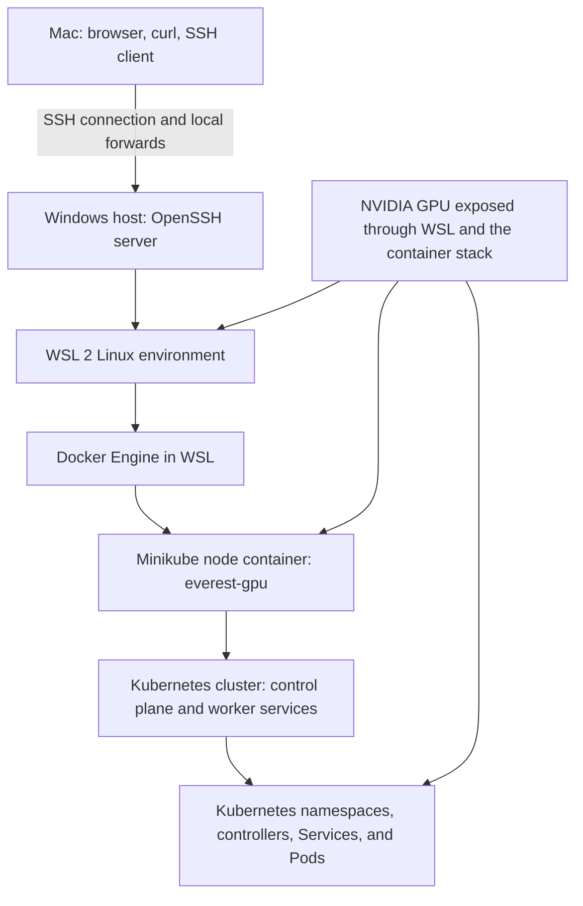
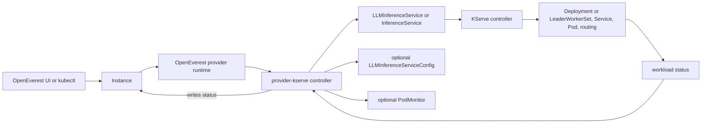
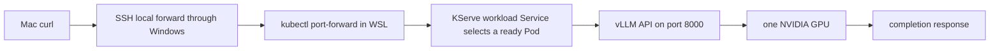
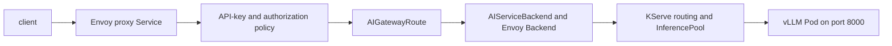
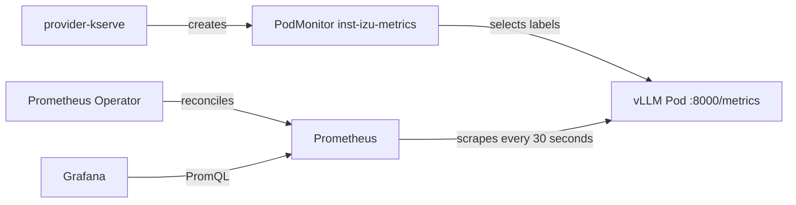
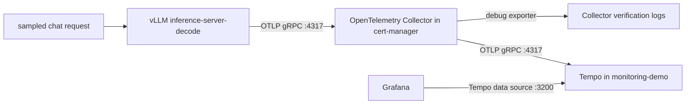

# Kubernetes and vLLM observability workshop guide

This guide explains the lab layers, Kubernetes ownership, vLLM metrics, Prometheus, Grafana, and OpenTelemetry.

Use it with these workshop documents:

- [WSL GPU demo runbook](wsl-gpu-demo-runbook.md)
- [WSL GPU lab findings](wsl-gpu-lab-findings.md)
- [WSL GPU workshop FAQ](wsl-gpu-workshop-faq.md)
- [Local Envoy AI Gateway rehearsal](envoy-ai-gateway-rehearsal.md)

## Evidence labels

This guide uses four labels:

- Observed lab fact: Evidence came from the workshop output.
- Verified lab procedure: The complete procedure ran successfully on the WSL Minikube cluster.
- Repository behavior: The current provider source, chart, or dashboard defines this behavior.
- Unverified procedure: The lab has not completed this procedure. Do not present it as a result.

The final observability run included a complete all-namespace Pod inventory. Commands still discover live names instead of assuming that old Pod names remain valid.

## Physical and Kubernetes layers

Observed lab fact: The local cluster uses the Minikube profile, context, and single node name `everest-gpu`.



These layers are not interchangeable. Docker runs the Minikube node container. Kubernetes runs inside that node. Kubernetes then schedules Pods inside its cluster.

`everest-gpu` is not an application namespace. It is the Minikube profile, kubectl context, and single node name in this lab.

## Bounded current state

Observed lab facts:

- The current model is `Qwen/Qwen3-0.6B`, served as `qwen3-0.6b`.
- Its working limits are one GPU, model length 2048, one sequence, and GPU memory utilization 0.7.
- A previous Instance named `inst-izu` ran in `cert-manager`.
- A later query for `deployment/inst-izu-kserve` returned `NotFound`.
- The user queried `default`, `everest`, and `everest-gpu` while looking for that Deployment.
- The observed namespace list contains neither `everest` nor `everest-gpu`.
- The previous model can have been deleted while the user freed the only GPU. This cause is not yet verified.

The last point is a bounded explanation, not a confirmed deletion history. Inventory the cluster before naming the current model Pod.

## Namespace map

Kubernetes creates `default`, `kube-node-lease`, `kube-public`, and `kube-system`. The other observed namespaces came from installed software.

| Observed namespace | Normal contents | Normal owner or creator | What the name does not prove |
|---|---|---|---|
| `cert-manager` | cert-manager controller, webhook, and CA injector | cert-manager installation | It does not prove that those Pods still run. A model Instance was also placed here earlier. |
| `default` | Workloads created without another namespace | Kubernetes creates the namespace. Users create its workloads. | It does not prove that `qwen-demo` or `inst-izu` exists there. |
| `everest-monitoring` | OpenEverest monitoring components, if that feature was installed | OpenEverest platform installation | It does not prove that Prometheus, Grafana, or Prometheus Operator exists. |
| `everest-system` | OpenEverest controllers, API, and UI components | OpenEverest installation | It does not prove exact Deployment or Pod names. |
| `kube-node-lease` | Node heartbeat `Lease` objects | Kubernetes control plane and kubelets | It is not an application workload namespace. |
| `kube-public` | Cluster information intended for broad read access | Kubernetes control plane | It does not contain public model ingress by default. |
| `kube-system` | Kubernetes and Minikube system components | Kubernetes and Minikube | It does not prove which add-ons are enabled. |
| `provider-kserve` | provider-kserve and bundled KServe controllers, according to chart settings | provider-kserve Helm release | It does not prove that optional gateway, monitoring, or LWS components run. |

Inspect namespace metadata and Helm releases before assigning ownership:

```bash
export PROFILE=everest-gpu
kubectl --context "$PROFILE" get namespaces --show-labels
kubectl --context "$PROFILE" get namespace cert-manager default everest-monitoring \
  everest-system kube-node-lease kube-public kube-system provider-kserve -o yaml
helm --kube-context "$PROFILE" list --all-namespaces
```

## Dynamic workload and controller inventory

Run these commands in WSL. They discover names from the API instead of assuming names from old output.

```bash
export PROFILE=everest-gpu
kubectl config get-contexts
minikube profile list
kubectl --context "$PROFILE" get nodes
kubectl --context "$PROFILE" get namespaces
kubectl --context "$PROFILE" get pods -A \
  -o custom-columns='NAMESPACE:.metadata.namespace,POD:.metadata.name,OWNER_KIND:.metadata.ownerReferences[0].kind,OWNER_NAME:.metadata.ownerReferences[0].name,NODE:.spec.nodeName,PHASE:.status.phase,READY:.status.containerStatuses[*].ready'
kubectl --context "$PROFILE" get deployments.apps,statefulsets.apps,daemonsets.apps -A
kubectl --context "$PROFILE" get services -A
```

Inventory the domain resources separately. `kubectl get all` does not include every CRD-backed resource.

```bash
kubectl --context "$PROFILE" get instances.core.openeverest.io -A
kubectl --context "$PROFILE" get providers.core.openeverest.io
kubectl --context "$PROFILE" get instancepresets.core.openeverest.io
kubectl --context "$PROFILE" get llminferenceservices.serving.kserve.io -A
kubectl --context "$PROFILE" get llminferenceserviceconfigs.serving.kserve.io -A
kubectl --context "$PROFILE" get inferenceservices.serving.kserve.io -A
kubectl --context "$PROFILE" get podmonitors.monitoring.coreos.com -A
```

| Pod or controller class | Role | Normal owner chain | Inventory rule |
|---|---|---|---|
| Kubernetes control-plane Pod | API, scheduling, and core reconciliation | Minikube or Kubernetes static-Pod configuration | Read `kube-system`. Do not assume component names. |
| OpenEverest Pod | UI, API, and Instance control | OpenEverest workload controller | Read `everest-system` and owner references. |
| provider-kserve Pod | Translates an `Instance` into KServe resources | provider-kserve Deployment | Read `provider-kserve` and its Deployment. |
| KServe controller Pod | Reconciles KServe CRs into workloads and networking | KServe controller Deployment | Read all namespaces and chart releases. |
| vLLM model Pod | Serves the model and `/metrics` on port 8000 | KServe workload, commonly through a Deployment or LeaderWorkerSet | Select by labels. Do not copy an old Pod name. |
| cert-manager Pod | Reconciles certificate resources | cert-manager Deployment | Read `cert-manager` and owner references. |
| Prometheus Operator Pod | Reconciles `Prometheus` and `PodMonitor` resources | kube-prometheus-stack Deployment | Verified in `monitoring-demo`; inventory the live Deployment. |
| Prometheus Pod | Scrapes and stores metrics | `Prometheus` CR through the operator | Verified in `monitoring-demo`; discover the StatefulSet Pod dynamically. |
| Grafana Pod | Queries Prometheus and Tempo and renders dashboards | kube-prometheus-stack Deployment | Verified in `monitoring-demo`; discover the Deployment Pod dynamically. |
| OpenTelemetry Collector Pod | Receives, batches, and exports OTLP spans | OpenTelemetry Collector Deployment | Verified in `cert-manager`; its Service name must match the KServe endpoint. |
| Tempo Pod | Stores and queries traces | Tempo StatefulSet | Verified in `monitoring-demo`; this lab uses ephemeral trace storage. |
| Gateway controller and proxy Pods | Reconcile and serve the optional gateway path | Envoy Gateway and AI Gateway resources | Treat as optional and unverified in this lab. |

## Control plane and CRD ownership

Repository behavior: provider-kserve watches matching OpenEverest Instances. It creates KServe resources and reports status. KServe, not provider-kserve, manages the model workload Pods.



| API group and resources | Scope | CRD and reconciliation owner | Purpose in this stack |
|---|---|---|---|
| `core.openeverest.io`: `Instance` | Namespaced | OpenEverest defines the CRD. provider-kserve reconciles matching Instances. | User-facing desired model state and status. |
| `core.openeverest.io`: `Provider`, `InstancePreset` | Cluster | OpenEverest defines them. The provider chart creates provider metadata and presets. | Provider registration, UI schema, and reusable presets. |
| `serving.kserve.io`: `LLMInferenceService`, `LLMInferenceServiceConfig` | Namespaced | KServe defines and reconciles them. provider-kserve creates them. | LLM workload and reusable merged configuration. |
| `serving.kserve.io`: `InferenceService` | Namespaced | KServe InferenceService controller | Predictor workloads. It is separate from the LLM topology. |
| `serving.kserve.io`: `ServingRuntime`, `ClusterServingRuntime` | Namespaced or cluster | KServe | Runtime definitions used by predictor workloads. |
| `serving.kserve.io`: `StorageContainer`, `ClusterStorageContainer` | Namespaced or cluster | KServe | Storage initializer behavior for supported model URIs. |
| `monitoring.coreos.com`: `PodMonitor` | Namespaced | Prometheus Operator defines the CRD. provider-kserve can create each Instance object. | Selects model Pods and the `/metrics` endpoint. |
| `gateway.networking.k8s.io`: `GatewayClass`, `Gateway`, `HTTPRoute` | Cluster or namespaced | Gateway API and a selected gateway controller | Optional traffic entry and HTTP routing. |
| `gateway.envoyproxy.io`: `EnvoyProxy`, `Backend`, traffic and security policies | Namespaced | Envoy Gateway | Optional proxy configuration, backends, authentication, and policy. |
| `aigateway.envoyproxy.io`: `AIGatewayRoute`, `AIServiceBackend` | Namespaced | Envoy AI Gateway, also named Agent Router upstream | Optional AI request routing and backend schema mapping. |
| `cert-manager.io`: `Certificate`, `Issuer`, `ClusterIssuer` | Namespaced or cluster | cert-manager | Optional certificate issuance and renewal. |
| `leaderworkerset.x-k8s.io`: `LeaderWorkerSet` | Namespaced | LeaderWorkerSet controller | Optional multi-node worker groups. The one-GPU model does not need it. |

Discover the installed API surface before querying optional resources:

```bash
kubectl --context "$PROFILE" api-resources --api-group=core.openeverest.io -o wide
kubectl --context "$PROFILE" api-resources --api-group=serving.kserve.io -o wide
kubectl --context "$PROFILE" api-resources --api-group=monitoring.coreos.com -o wide
kubectl --context "$PROFILE" api-resources --api-group=gateway.networking.k8s.io -o wide
kubectl --context "$PROFILE" api-resources --api-group=gateway.envoyproxy.io -o wide
kubectl --context "$PROFILE" api-resources --api-group=aigateway.envoyproxy.io -o wide
kubectl --context "$PROFILE" api-resources --api-group=cert-manager.io -o wide
kubectl --context "$PROFILE" api-resources --api-group=leaderworkerset.x-k8s.io -o wide
```

## Request paths

Observed direct path:



This is a debug path. SSH and `kubectl port-forward` are not ingress or gateway validation.

Repository behavior, optional gateway path:



Unverified procedure: The WSL lab has not proved this gateway path. Use the [gateway rehearsal](envoy-ai-gateway-rehearsal.md) before making a gateway claim.

## Direct vLLM observations and commands

Repository behavior: vLLM exposes its OpenAI-compatible API and `/metrics` on port 8000. Metric names can change between vLLM versions.

Start a direct, local port-forward to the dynamically selected model Pod:

```bash
export PROFILE=everest-gpu
export INSTANCE_NS=default
export INSTANCE=qwen-demo
POD="$(kubectl --context "$PROFILE" -n "$INSTANCE_NS" get pods \
  -l "core.openeverest.io/instance=$INSTANCE,core.openeverest.io/component=llmEngine" \
  -o jsonpath='{.items[0].metadata.name}')"
test -n "$POD"
kubectl --context "$PROFILE" -n "$INSTANCE_NS" port-forward "pod/$POD" 18000:8000
```

Run the next commands in another WSL shell:

```bash
export METRICS_URL=http://127.0.0.1:18000/metrics
curl --fail --silent --show-error http://127.0.0.1:18000/health
curl --fail --silent --show-error http://127.0.0.1:18000/v1/models | jq .

# Successful requests by finish reason
curl --fail --silent --show-error "$METRICS_URL" \
  | grep -E '^vllm:request_success(_total)?(\{| )'

# Input and output token counters
curl --fail --silent --show-error "$METRICS_URL" \
  | grep -E '^vllm:(prompt_tokens|generation_tokens)(_total)?(\{| )'

# Running and waiting requests
curl --fail --silent --show-error "$METRICS_URL" \
  | grep -E '^vllm:num_requests_(running|waiting)(\{| )'

# KV-cache use. The pinned and later vLLM releases use different names.
curl --fail --silent --show-error "$METRICS_URL" \
  | grep -E '^vllm:(gpu_cache_usage_perc|cpu_cache_usage_perc|kv_cache_usage_perc)(\{| )'

# Prefix-cache queried tokens and hit tokens
curl --fail --silent --show-error "$METRICS_URL" \
  | grep -E '^vllm:(prefix_cache_queries|prefix_cache_hits)(_total)?(\{| )'

# Raw histogram buckets, sums, and counts
curl --fail --silent --show-error "$METRICS_URL" \
  | grep -E '^vllm:(time_to_first_token_seconds|time_per_output_token_seconds|inter_token_latency_seconds|e2e_request_latency_seconds|request_queue_time_seconds)_(bucket|sum|count)(\{| )'
```

The histogram output is raw cumulative data. Prometheus calculates rates and quantiles across time windows. A single `/metrics` response does not contain a calculated p95.

Observe GPU state from the same dynamically selected Pod:

```bash
export PROFILE=everest-gpu
export INSTANCE_NS=default
export INSTANCE=qwen-demo
POD="$(kubectl --context "$PROFILE" -n "$INSTANCE_NS" get pods \
  -l "core.openeverest.io/instance=$INSTANCE,core.openeverest.io/component=llmEngine" \
  -o jsonpath='{.items[0].metadata.name}')"
test -n "$POD"
kubectl --context "$PROFILE" -n "$INSTANCE_NS" exec "$POD" -c main -- nvidia-smi
```

### What the observed counters mean

Observed lab fact: `vllm:request_success_total{finished_reason="stop"}` was `1`. Every other exposed finish-reason series was `0`.

This means one request finished with the `stop` reason since the vLLM process started. It does not mean one request is running now. It also does not prove throughput, reliability, or model quality. Counters reset when the process restarts.

Observed lab fact: Before the first long prompt, prefix queries were `29` and hits were `0`. After the 987-token prompt, queries were `1016` and hits remained `0`.

The query counter increased by `1016 - 29 = 987` queried tokens. The first request had no prior copy of that prefix to reuse. vLLM populated cache entries while processing it, so zero hits were expected. The first request alone does not prove reuse.

Run the exact same serialized request a second time. Keep the prompt, chat template fields, and model name unchanged. Cache eviction or disabled prefix caching can still prevent a positive result.

Save the exact long prompt as `/tmp/long-prompt.txt`, then run this unverified procedure:

```bash
export METRICS_URL=http://127.0.0.1:18000/metrics
export REQUEST_URL=http://127.0.0.1:18000/v1/chat/completions
test -s /tmp/long-prompt.txt
jq -n --rawfile prompt /tmp/long-prompt.txt '{
  model: "qwen3-0.6b",
  messages: [{role: "user", content: $prompt}],
  chat_template_kwargs: {enable_thinking: false},
  max_tokens: 32,
  temperature: 0
}' > /tmp/prefix-cache-request.json

metric_snapshot() {
  curl --fail --silent --show-error "$METRICS_URL" \
    | grep -E '^vllm:(prefix_cache_queries|prefix_cache_hits)(_total)?(\{| )'
}

metric_snapshot > /tmp/prefix-before.txt
curl --fail-with-body --silent --show-error "$REQUEST_URL" \
  -H 'Content-Type: application/json' \
  --data @/tmp/prefix-cache-request.json \
  --output /tmp/prefix-response-1.json
metric_snapshot > /tmp/prefix-after-first.txt
curl --fail-with-body --silent --show-error "$REQUEST_URL" \
  -H 'Content-Type: application/json' \
  --data @/tmp/prefix-cache-request.json \
  --output /tmp/prefix-response-2.json
metric_snapshot > /tmp/prefix-after-second.txt
cat /tmp/prefix-before.txt /tmp/prefix-after-first.txt /tmp/prefix-after-second.txt
```

A higher hit counter after the second identical request proves token reuse for that run. Compare deltas, not only absolute values.

Observed lab fact: The response redirection was entered on a separate line. The response printed to the terminal. The later standalone redirection opened or truncated a file but could not capture earlier output.

Keep redirection on the same command, or use `--output` as the procedure does:

```bash
curl --fail-with-body --silent --show-error "$REQUEST_URL" \
  -H 'Content-Type: application/json' \
  --data @/tmp/prefix-cache-request.json \
  --output /tmp/prefix-response.json
```

KV cache and prefix cache answer different questions. KV-cache use measures occupied capacity. Prefix-cache hits measure reused prompt tokens. High KV use does not imply a high prefix hit rate.

## Verified Prometheus and Grafana deployment

Repository behavior: provider-kserve does not install Prometheus or Grafana. It creates one `PodMonitor` per Instance only when metrics are enabled and the `monitoring.coreos.com/v1` `PodMonitor` CRD exists.

The verified metrics path is:



### Verified component versions

| Component | Verified version |
|---|---|
| kube-prometheus-stack chart | `92.11.0` |
| Prometheus | `v3.15.0-distroless` |
| Grafana | `13.2.4` |
| Tempo chart | `3.2.1` |
| Tempo | `3.1.1` |
| OpenTelemetry Collector chart | `0.177.0` |
| OpenTelemetry Collector | `0.163.2` |

The monitoring stack ran in `monitoring-demo`. The model Instance, generated `PodMonitor`, vLLM Pod, and OpenTelemetry Collector ran in `cert-manager`. Keeping an application model in `cert-manager` is not recommended, but this placement documents the verified lab instead of rewriting its history.

### Inventory before installation

Run the inventory first. The existence of `everest-monitoring` does not prove that Prometheus Operator, Prometheus, or Grafana is installed.

```bash
export PROFILE=everest-gpu
kubectl --context "$PROFILE" get pods -A -o wide
kubectl --context "$PROFILE" get instances.core.openeverest.io -A
kubectl --context "$PROFILE" get llminferenceservices.serving.kserve.io -A
helm --kube-context "$PROFILE" list -A
kubectl --context "$PROFILE" get crd podmonitors.monitoring.coreos.com
kubectl --context "$PROFILE" get crd prometheuses.monitoring.coreos.com
```

Before installation, both monitoring CRD lookups returned `NotFound`. The `everest-monitoring` namespace contained VictoriaMetrics Operator integration, not this Prometheus and Grafana stack.

### Install the bounded monitoring stack

The final values keep one Prometheus replica, short retention, no persistent storage, and no Alertmanager, node-exporter, or kube-state-metrics workload. Prometheus discovers `PodMonitor` objects across namespaces without requiring a Helm release label.

```bash
helm repo add prometheus-community \
  https://prometheus-community.github.io/helm-charts \
  --force-update
helm repo update

kubectl --context "$PROFILE" create namespace monitoring-demo \
  --dry-run=client -o yaml \
  | kubectl --context "$PROFILE" apply -f -

cat >/tmp/kube-prometheus-stack-values.yaml <<'EOF'
alertmanager:
  enabled: false

grafana:
  enabled: true
  resources:
    requests:
      cpu: 50m
      memory: 256Mi
    limits:
      memory: 512Mi

kubeStateMetrics:
  enabled: false

nodeExporter:
  enabled: false

prometheusOperator:
  resources:
    requests:
      cpu: 50m
      memory: 128Mi
    limits:
      memory: 256Mi

prometheus:
  prometheusSpec:
    retention: 2h
    scrapeInterval: 15s
    podMonitorSelectorNilUsesHelmValues: false
    podMonitorSelector: {}
    podMonitorNamespaceSelector: {}
    resources:
      requests:
        cpu: 100m
        memory: 256Mi
      limits:
        memory: 512Mi
EOF

helm upgrade --install observability \
  prometheus-community/kube-prometheus-stack \
  --namespace monitoring-demo \
  --values /tmp/kube-prometheus-stack-values.yaml \
  --wait \
  --timeout 10m
```

Verify the controllers and API types:

```bash
kubectl --context "$PROFILE" -n monitoring-demo get pods
kubectl --context "$PROFILE" get crd \
  podmonitors.monitoring.coreos.com \
  prometheuses.monitoring.coreos.com
kubectl --context "$PROFILE" get prometheuses.monitoring.coreos.com -A
```

### Trigger PodMonitor reconciliation

The Instance already had `enableMetrics: true`. The provider had reconciled it before the Prometheus Operator CRD existed, so no `PodMonitor` was present immediately after the monitoring installation.

Touching an annotation generated another Instance event without changing model configuration:

```bash
export INSTANCE_NS=cert-manager
export INSTANCE=inst-izu

kubectl --context "$PROFILE" -n "$INSTANCE_NS" annotate \
  instance "$INSTANCE" \
  "observability-demo-refresh=$(date +%s)" \
  --overwrite
```

The next reconciliation created `inst-izu-metrics`:

```bash
kubectl --context "$PROFILE" -n "$INSTANCE_NS" get podmonitor
kubectl --context "$PROFILE" -n "$INSTANCE_NS" get \
  podmonitor inst-izu-metrics -o yaml
kubectl --context "$PROFILE" -n "$INSTANCE_NS" get pods --show-labels
```

Its effective contract was:

```yaml
spec:
  podMetricsEndpoints:
    - interval: 30s
      path: /metrics
      targetPort: 8000
  selector:
    matchLabels:
      app.kubernetes.io/name: inst-izu
      app.kubernetes.io/part-of: llminferenceservice
      kserve.io/component: workload
```

Prometheus selected all `PodMonitor` labels and namespaces:

```bash
kubectl --context "$PROFILE" -n monitoring-demo get prometheus \
  observability-kube-prometh-prometheus \
  -o jsonpath='podMonitorSelector={.spec.podMonitorSelector}{" namespaceSelector="}{.spec.podMonitorNamespaceSelector}{"\n"}'
```

Verified output:

```text
podMonitorSelector={} namespaceSelector={}
```

### Verify Prometheus without Grafana

Wait at least one 30-second `PodMonitor` interval, then query Prometheus through the Kubernetes API proxy:

```bash
kubectl --context "$PROFILE" get --raw \
  '/api/v1/namespaces/monitoring-demo/services/http:observability-kube-prometh-prometheus:9090/proxy/api/v1/query?query=up%7Bnamespace%3D%22cert-manager%22%7D'

kubectl --context "$PROFILE" get --raw \
  '/api/v1/namespaces/monitoring-demo/services/http:observability-kube-prometh-prometheus:9090/proxy/api/v1/query?query=vllm%3Arequest_success_total'
```

Verified result:

- The `cert-manager/inst-izu-metrics` target returned `up = 1`.
- The scrape endpoint was the current vLLM Pod on port 8000.
- Prometheus returned five `vllm:request_success_total` series.
- The series carried `namespace`, `pod`, `model_name`, and `finished_reason` labels.

Useful PromQL:

```promql
vllm:request_success_total
```

```promql
sum(rate(vllm:generation_tokens_total[1m]))
```

```promql
vllm:num_requests_running
```

```promql
vllm:num_requests_waiting
```

```promql
{__name__=~"vllm:(gpu|kv)_cache_usage_perc"}
```

```promql
histogram_quantile(
  0.95,
  sum(rate(vllm:time_to_first_token_seconds_bucket[5m])) by (le)
)
```

### Provision the vLLM dashboard

The provider dashboard is provisioned through a labeled ConfigMap. This is preferable to a one-time API import because the Grafana sidecar restores it after a Pod replacement.

```bash
curl --fail --location \
  --output /tmp/vllm-dashboard.json \
  https://raw.githubusercontent.com/openeverest/provider-kserve/main/docs/dashboards/vllm.json

kubectl --context "$PROFILE" -n monitoring-demo create configmap \
  grafana-dashboard-vllm \
  --from-file=vllm.json=/tmp/vllm-dashboard.json \
  --dry-run=client -o yaml \
  | kubectl label --local -f - grafana_dashboard=1 -o yaml \
  | kubectl --context "$PROFILE" apply -f -

kubectl --context "$PROFILE" -n monitoring-demo get \
  configmap grafana-dashboard-vllm --show-labels
```

The provisioned dashboard UID is `provider-kserve-vllm`. Its panels cover token throughput, running and waiting requests, TTFT, inter-token latency, KV-cache use, end-to-end latency, successes, and preemptions.

### Metrics-specific failure and fix

| Observation | Cause | Fix | Proof |
|---|---|---|---|
| `PodMonitor` CRD was absent | provider-kserve does not install Prometheus Operator | Install kube-prometheus-stack | Both monitoring CRDs became available |
| No `PodMonitor` appeared immediately after installation | The Instance had already reconciled while the CRD was absent | Update a harmless Instance annotation to trigger reconciliation | `inst-izu-metrics` was created |
| A valid monitor could have been ignored | Prometheus selectors often require release labels or limit namespaces | Set empty PodMonitor label and namespace selectors | Target returned `up = 1` |
| A one-time dashboard import would not survive replacement without persistent Grafana storage | The dashboard existed only in Grafana's runtime database | Provision it with a labeled ConfigMap | Grafana reported the dashboard as provisioned |

## Verified OpenTelemetry and Tempo traces

Metrics and traces are separate telemetry signals. Prometheus scrapes numeric series. Instrumented components export per-request spans over OTLP.



### Inspect KServe tracing configuration

The Instance already had tracing enabled:

```bash
kubectl --context "$PROFILE" -n "$INSTANCE_NS" get instance "$INSTANCE" \
  -o jsonpath='{.spec.topology.parameters}{"\n"}'

kubectl --context "$PROFILE" -n "$INSTANCE_NS" get \
  llminferenceservice.serving.kserve.io "$INSTANCE" \
  -o jsonpath='{.spec.tracing}{"\n"}'
```

The generated `spec.tracing` was `{}`, so KServe applied its defaults. Inspect the current model Pod environment:

```bash
POD="$(kubectl --context "$PROFILE" -n "$INSTANCE_NS" get pods \
  -l "app.kubernetes.io/name=$INSTANCE,kserve.io/component=workload" \
  -o jsonpath='{.items[?(@.status.phase=="Running")].metadata.name}')"
test -n "$POD"

kubectl --context "$PROFILE" -n "$INSTANCE_NS" exec "$POD" -c main -- \
  printenv OTEL_EXPORTER_OTLP_ENDPOINT
kubectl --context "$PROFILE" -n "$INSTANCE_NS" exec "$POD" -c main -- \
  printenv OTEL_SERVICE_NAME
kubectl --context "$PROFILE" -n "$INSTANCE_NS" exec "$POD" -c main -- \
  printenv OTEL_TRACES_SAMPLER
kubectl --context "$PROFILE" -n "$INSTANCE_NS" exec "$POD" -c main -- \
  printenv OTEL_TRACES_SAMPLER_ARG
kubectl --context "$PROFILE" -n "$INSTANCE_NS" exec "$POD" -c main -- \
  printenv OTEL_RESOURCE_ATTRIBUTES
```

Verified values:

```text
OTEL_EXPORTER_OTLP_ENDPOINT=http://otel-collector:4317
OTEL_SERVICE_NAME=inference-server-decode
OTEL_TRACES_SAMPLER=parentbased_traceidratio
OTEL_TRACES_SAMPLER_ARG=0.05
```

The resource attributes included:

```text
k8s.namespace.name=cert-manager
llmisvc.name=inst-izu
```

The short endpoint name `otel-collector` resolves inside the model namespace. Deploying the Collector Service in `cert-manager` therefore satisfied the existing endpoint without changing the Instance or restarting the model.

### Install Tempo

The monolithic Tempo chart is sufficient for this one-node lab. It uses local ephemeral storage, so traces do not survive a Tempo Pod replacement.

```bash
helm repo add grafana-community \
  https://grafana-community.github.io/helm-charts \
  --force-update
helm repo update

cat >/tmp/tempo-values.yaml <<'EOF'
replicas: 1

tempo:
  reportingEnabled: false
  resources:
    requests:
      cpu: 100m
      memory: 256Mi
    limits:
      memory: 768Mi

persistence:
  enabled: false

service:
  type: ClusterIP
EOF

helm upgrade --install tempo grafana-community/tempo \
  --version 3.2.1 \
  --namespace monitoring-demo \
  --values /tmp/tempo-values.yaml \
  --wait \
  --timeout 10m
```

Verify the query and OTLP ports:

```bash
kubectl --context "$PROFILE" -n monitoring-demo get pod tempo-0
kubectl --context "$PROFILE" -n monitoring-demo get service tempo
```

The verified Service exposed Tempo HTTP query port 3200 and OTLP gRPC port 4317.

### Install the OpenTelemetry Collector

The Collector receives model spans over OTLP gRPC, writes a bounded verification summary to its logs, batches spans, and exports them to Tempo.

```bash
helm repo add open-telemetry \
  https://open-telemetry.github.io/opentelemetry-helm-charts \
  --force-update
helm repo update

cat >/tmp/otel-collector-values.yaml <<'EOF'
mode: deployment
fullnameOverride: otel-collector

image:
  repository: otel/opentelemetry-collector-k8s

config:
  exporters:
    debug:
      verbosity: normal
    otlp_grpc/tempo:
      endpoint: tempo.monitoring-demo.svc.cluster.local:4317
      tls:
        insecure: true

  receivers:
    otlp:
      protocols:
        grpc:
          endpoint: 0.0.0.0:4317
        http:
          endpoint: 0.0.0.0:4318

  service:
    pipelines:
      traces:
        receivers: [otlp]
        processors: [memory_limiter, batch]
        exporters: [debug, otlp_grpc/tempo]

resources:
  requests:
    cpu: 50m
    memory: 128Mi
  limits:
    memory: 256Mi
EOF

helm upgrade --install otel-collector \
  open-telemetry/opentelemetry-collector \
  --version 0.177.0 \
  --namespace "$INSTANCE_NS" \
  --values /tmp/otel-collector-values.yaml \
  --wait \
  --timeout 10m
```

Verify the namespace-local endpoint:

```bash
kubectl --context "$PROFILE" -n "$INSTANCE_NS" get \
  pod,service -l app.kubernetes.io/instance=otel-collector
kubectl --context "$PROFILE" -n "$INSTANCE_NS" get \
  endpointslices.discovery.k8s.io \
  -l kubernetes.io/service-name=otel-collector
```

A ready Collector Pod and a populated EndpointSlice prove network discovery. They do not prove span receipt or Tempo export.

### Generate a deterministically sampled trace

The default sampler records approximately 5 percent of unparented requests. A W3C `traceparent` header with the sampled flag set to `01` makes this verification deterministic under the parent-based sampler.

```bash
TRACE_ID="$(openssl rand -hex 16)"
PARENT_SPAN_ID="$(openssl rand -hex 8)"

kubectl --context "$PROFILE" -n "$INSTANCE_NS" exec "$POD" -c main -- \
  curl --fail-with-body --silent --show-error \
  http://127.0.0.1:8000/v1/chat/completions \
  -H 'Content-Type: application/json' \
  -H "traceparent: 00-${TRACE_ID}-${PARENT_SPAN_ID}-01" \
  --data '{
    "model": "qwen3-0.6b",
    "messages": [
      {
        "role": "user",
        "content": "Reply with exactly: trace works"
      }
    ],
    "chat_template_kwargs": {
      "enable_thinking": false
    },
    "temperature": 0,
    "max_tokens": 16
  }'

printf 'Trace ID: %s\n' "$TRACE_ID"
```

The verified request returned `trace works`.

### Prove Collector receipt and export

Inspect the Collector:

```bash
kubectl --context "$PROFILE" -n "$INSTANCE_NS" logs \
  deployment/otel-collector \
  --since=5m \
  | grep -F 'llm_request'

kubectl --context "$PROFILE" -n "$INSTANCE_NS" logs \
  deployment/otel-collector \
  --since=5m \
  | grep -F 'otelcol_exporter_sent_spans'
```

Verified span attributes included:

```text
service.name=inference-server-decode
llmisvc.name=inst-izu
gen_ai.usage.prompt_tokens=18
gen_ai.usage.completion_tokens=3
gen_ai.latency.time_to_first_token=0.15580511093139648
gen_ai.latency.e2e=0.22567963600158691
gen_ai.request.id=chatcmpl-96f32a075cf561de
```

Collector internal telemetry proved:

```text
otelcol_receiver_accepted_spans{receiver=otlp,transport=grpc} 1
otelcol_receiver_failed_spans{receiver=otlp,transport=grpc} 0
otelcol_exporter_sent_spans{exporter=otlp_grpc/tempo,...} 1
```

Query Tempo directly through the Kubernetes API proxy:

```bash
kubectl --context "$PROFILE" get --raw \
  "/api/v1/namespaces/monitoring-demo/services/http:tempo:3200/proxy/api/traces/$TRACE_ID"
```

A returned trace proves backend storage. Collector logs alone prove receipt, not storage.

### Provision the Tempo data source

Provision Tempo through the Grafana datasource sidecar so the configuration survives Grafana Pod replacement:

```bash
cat >/tmp/grafana-datasource-tempo.yaml <<'EOF'
apiVersion: v1
kind: ConfigMap
metadata:
  name: grafana-datasource-tempo
  namespace: monitoring-demo
  labels:
    grafana_datasource: "1"
data:
  tempo.yaml: |
    apiVersion: 1
    datasources:
      - name: Tempo
        uid: tempo
        type: tempo
        access: proxy
        url: http://tempo.monitoring-demo.svc.cluster.local:3200
        isDefault: false
        editable: true
        jsonData:
          httpMethod: GET
          nodeGraph:
            enabled: true
          serviceMap:
            datasourceUid: prometheus
          tracesToMetrics:
            datasourceUid: prometheus
EOF

kubectl --context "$PROFILE" apply \
  -f /tmp/grafana-datasource-tempo.yaml
kubectl --context "$PROFILE" -n monitoring-demo get \
  configmap grafana-datasource-tempo --show-labels
```

The verified Grafana datasource health response was:

```text
status=OK
message=Data source is working
```

Grafana then retrieved the sampled trace through the Tempo datasource. This proves the complete model to Collector to Tempo to Grafana path.

### Trace-specific failure and fix

| Observation | Cause | Fix | Proof |
|---|---|---|---|
| Tracing was enabled but no trace backend existed | KServe injected an OTLP endpoint, but no `otel-collector` Service resolved in the model namespace | Install the Collector with `fullnameOverride: otel-collector` in `cert-manager` | Collector received the sampled `llm_request` span |
| Collector receipt alone did not provide trace search or retention | The debug exporter only writes verification logs | Install monolithic Tempo and add an OTLP gRPC exporter | Collector reported one span exported to Tempo |
| The first exporter name produced a deprecation warning | Collector `0.163.2` renamed exporter type `otlp` to `otlp_grpc` | Use `otlp_grpc/tempo` in the final values | Helm upgrade completed without the exporter rename warning |
| API-created Grafana resources would not survive Pod replacement without persistent storage | Dashboard and datasource state existed only in the runtime database | Provision both through labeled ConfigMaps | Grafana marked the dashboard as provisioned and reported Tempo healthy |

### Final verified observability state

```text
vLLM metrics:
  vLLM /metrics
    -> inst-izu-metrics PodMonitor
    -> Prometheus
    -> Grafana vLLM dashboard

vLLM traces:
  inference-server-decode
    -> OTLP gRPC
    -> otel-collector
    -> Tempo
    -> Grafana Tempo data source
```

Final health evidence:

- Grafana database health: `ok`.
- Prometheus vLLM target: `up`.
- Prometheus vLLM request series: five.
- Tempo datasource health: `OK`.
- Sampled request response: `trace works`.
- Collector accepted spans: one.
- Collector failed spans: zero.
- Collector exported spans to Tempo: one.
- Tempo returned the exact trace.
- Grafana retrieved the exact trace from Tempo.
- Prometheus, Grafana, Tempo, and Collector Pods were `Running` with zero restarts after the final configuration.

### Optional cleanup

Disable tracing before removing the Collector if the lab no longer retains the trace stack:

```bash
kubectl --context "$PROFILE" -n "$INSTANCE_NS" patch instance "$INSTANCE" \
  --type=merge \
  --patch '{"spec":{"topology":{"parameters":{"enableTracing":false,"tracingEndpoint":null}}}}'

helm --kube-context "$PROFILE" uninstall otel-collector \
  --namespace "$INSTANCE_NS"
helm --kube-context "$PROFILE" uninstall tempo \
  --namespace monitoring-demo
kubectl --context "$PROFILE" -n monitoring-demo delete \
  configmap grafana-datasource-tempo
```

Remove the full metrics stack only when it is not shared with another workload:

```bash
helm --kube-context "$PROFILE" uninstall observability \
  --namespace monitoring-demo
kubectl --context "$PROFILE" delete namespace monitoring-demo
```

## Workshop Q&A

### Why did `kubectl get deployment inst-izu-kserve` return `NotFound`?

A Deployment lookup is namespace-scoped. The queried namespaces did not contain that object. The earlier object was in `cert-manager` and can have been deleted.

### Is `everest-gpu` a namespace?

No. In this lab it is the Minikube profile, kubectl context, and node name.

### Does a namespace prove that its software runs?

No. A namespace can remain after all Pods are gone. Use `kubectl get pods -A` and controller inventory.

### Which controller owns the model Pod?

KServe reconciles the generated workload. provider-kserve owns the translation from `Instance` to KServe resources, not direct Pod lifecycle.

### What is a CRD?

A CRD adds an API type to Kubernetes. A custom resource is one object of that type. A controller gives that object behavior.

### What does `vllm:request_success_total` count?

It counts completed requests by finish reason since process start. It is a counter, not current concurrency.

### Why were prefix-cache hits zero after the first long prompt?

The first request queried and populated the cache. It did not reuse an earlier identical prefix. Send the identical request again and compare deltas.

### Is KV-cache use the same as prefix-cache effectiveness?

No. KV use reports occupied capacity. Prefix hit rate reports how many queried prompt tokens came from cached prefixes.

### Does provider-kserve include Prometheus and Grafana?

No. It can create `PodMonitor` objects and optional dashboard ConfigMaps. A separate monitoring stack must select and use them.

### Why can a valid `PodMonitor` produce no Prometheus data?

Prometheus can exclude its namespace or labels. The monitor can also select no Pods or use an unreachable endpoint.

### Are metrics and OpenTelemetry traces interchangeable?

No. Prometheus scrapes numeric metrics. Instrumented components export trace spans through OTLP to a Collector and trace backend.

### What limits does one GPU impose here?

Only one GPU-backed model Pod can hold the device at a time. `max-num-seqs=1` also prevents a meaningful concurrency benchmark.

Do not test multi-worker serving, multi-GPU tensor parallelism, or a surge rollout on this lab. Preserve the working warm Pod during observability checks.

## Primary sources

Repository sources:

- [provider-kserve README](https://github.com/openeverest/provider-kserve/blob/main/README.md)
- [LLM topology definition](https://github.com/openeverest/provider-kserve/blob/main/definition/topologies/llm/types.go)
- [LLMInferenceService controller mapping](https://github.com/openeverest/provider-kserve/blob/main/internal/provider/llminferenceservice.go)
- [PodMonitor controller code](https://github.com/openeverest/provider-kserve/blob/main/internal/provider/podmonitor.go)
- [Chart dependencies](https://github.com/openeverest/provider-kserve/blob/main/charts/provider-kserve/Chart.yaml)
- [Chart observability values](https://github.com/openeverest/provider-kserve/blob/main/charts/provider-kserve/values.yaml)
- [Provider observability guide](https://github.com/openeverest/provider-kserve/blob/main/docs/observability.md)
- [vLLM dashboard](https://github.com/openeverest/provider-kserve/blob/main/docs/dashboards/vllm.json)

Official upstream sources:

- [Kubernetes namespaces](https://kubernetes.io/docs/concepts/overview/working-with-objects/namespaces/)
- [Kubernetes cluster architecture](https://kubernetes.io/docs/concepts/architecture/)
- [Kubernetes controllers](https://kubernetes.io/docs/concepts/architecture/controller/)
- [Kubernetes custom resources](https://kubernetes.io/docs/concepts/extend-kubernetes/api-extension/custom-resources/)
- [KServe control-plane API](https://kserve.github.io/website/docs/reference/crd-api)
- [KServe LLM configuration](https://kserve.github.io/website/docs/model-serving/generative-inference/llmisvc/llmisvc-configuration)
- [KServe tracing and observability](https://kserve.github.io/website/docs/model-serving/generative-inference/llmisvc/canary-rollout-observability)
- [Prometheus Operator API](https://prometheus-operator.dev/docs/api-reference/api/)
- [Prometheus metric types](https://prometheus.io/docs/concepts/metric_types/)
- [Grafana Prometheus data source](https://grafana.com/docs/grafana/latest/datasources/prometheus/)
- [vLLM 0.26.0 production metrics](https://docs.vllm.ai/en/v0.26.0/usage/metrics/)
- [vLLM automatic prefix caching](https://docs.vllm.ai/en/v0.26.0/features/automatic_prefix_caching/)
- [OpenTelemetry signals](https://opentelemetry.io/docs/concepts/signals/)
- [OpenTelemetry Collector components](https://opentelemetry.io/docs/collector/components/)
- [kube-prometheus-stack chart](https://github.com/prometheus-community/helm-charts/tree/main/charts/kube-prometheus-stack)
- [OpenTelemetry Collector Helm chart](https://opentelemetry.io/docs/platforms/kubernetes/helm/collector/)
- [OpenTelemetry Collector configuration](https://opentelemetry.io/docs/collector/configuration/)
- [Grafana Tempo Helm chart](https://grafana.com/docs/tempo/latest/setup/helm-chart/)
- [Grafana Tempo data source](https://grafana.com/docs/grafana/latest/datasources/tempo/)
- [Gateway API overview](https://gateway-api.sigs.k8s.io/docs/concepts/api-overview/)
- [Envoy AI Gateway API](https://aigateway.envoyproxy.io/docs/latest/api/)
- [cert-manager Gateway usage](https://cert-manager.io/docs/usage/gateway/)
