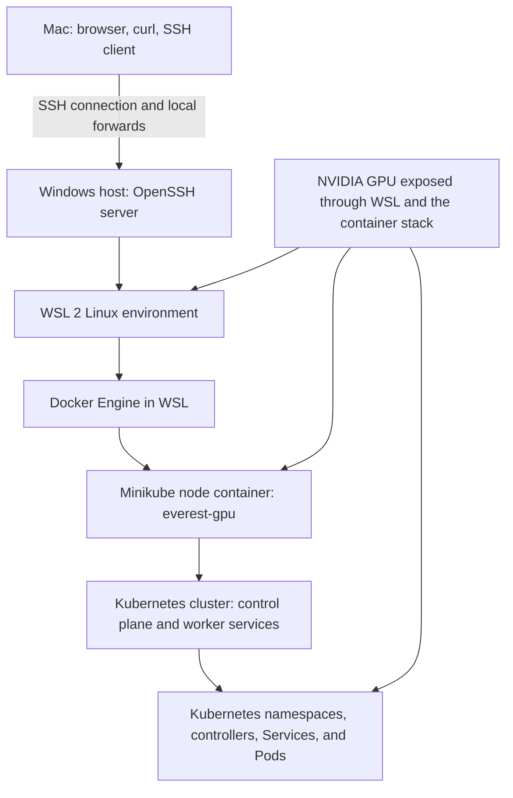
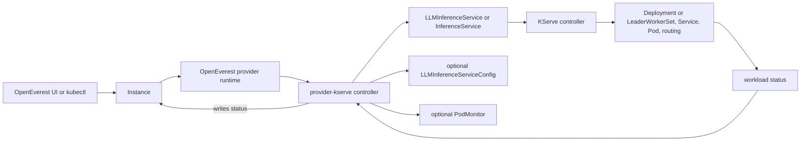
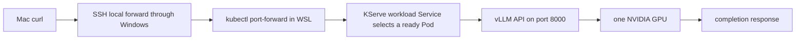
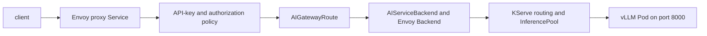
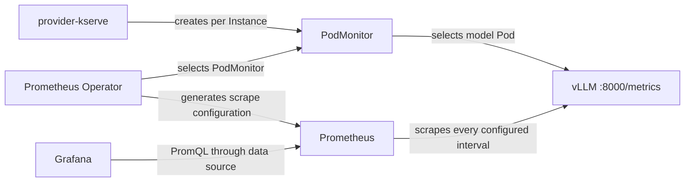
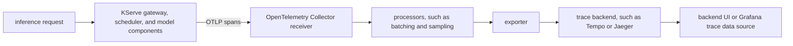

# Kubernetes and vLLM observability workshop guide

This guide explains the lab layers, Kubernetes ownership, vLLM metrics, Prometheus, Grafana, and OpenTelemetry.

Use it with these workshop documents:

- [WSL GPU demo runbook](wsl-gpu-demo-runbook.md)
- [WSL GPU lab findings](wsl-gpu-lab-findings.md)
- [WSL GPU workshop FAQ](wsl-gpu-workshop-faq.md)
- [Local Envoy AI Gateway rehearsal](envoy-ai-gateway-rehearsal.md)

## Evidence labels

This guide uses three labels:

- Observed lab fact: Evidence came from the workshop output.
- Repository behavior: The current provider source, chart, or dashboard defines this behavior.
- Unverified procedure: The lab has not completed this procedure. Do not present it as a result.

Do not infer a live Pod inventory from namespace names. The workshop has not supplied `kubectl get pods -A` output.

## Physical and Kubernetes layers

Observed lab fact: The local cluster uses the Minikube profile, context, and single node name `everest-gpu`.



These layers are not interchangeable. Docker runs the Minikube node container. Kubernetes runs inside that node. Kubernetes then schedules Pods inside its cluster.

`everest-gpu` is not an application namespace. It is the Minikube profile, kubectl context, and single node name in this lab.

## Bounded current state

Observed lab facts:

- The current model is `Qwen/Qwen3-0.6B`, served as `qwen3-0.6b`.
- Its working limits are one GPU, model length 2048, one sequence, and GPU memory utilization 0.7.
- A previous Instance named `inst-izu` ran in `cert-manager`.
- A later query for `deployment/inst-izu-kserve` returned `NotFound`.
- The user queried `default`, `everest`, and `everest-gpu` while looking for that Deployment.
- The observed namespace list contains neither `everest` nor `everest-gpu`.
- The previous model can have been deleted while the user freed the only GPU. This cause is not yet verified.

The last point is a bounded explanation, not a confirmed deletion history. Inventory the cluster before naming the current model Pod.

## Namespace map

Kubernetes creates `default`, `kube-node-lease`, `kube-public`, and `kube-system`. The other observed namespaces came from installed software.

| Observed namespace | Normal contents | Normal owner or creator | What the name does not prove |
|---|---|---|---|
| `cert-manager` | cert-manager controller, webhook, and CA injector | cert-manager installation | It does not prove that those Pods still run. A model Instance was also placed here earlier. |
| `default` | Workloads created without another namespace | Kubernetes creates the namespace. Users create its workloads. | It does not prove that `qwen-demo` or `inst-izu` exists there. |
| `everest-monitoring` | OpenEverest monitoring components, if that feature was installed | OpenEverest platform installation | It does not prove that Prometheus, Grafana, or Prometheus Operator exists. |
| `everest-system` | OpenEverest controllers, API, and UI components | OpenEverest installation | It does not prove exact Deployment or Pod names. |
| `kube-node-lease` | Node heartbeat `Lease` objects | Kubernetes control plane and kubelets | It is not an application workload namespace. |
| `kube-public` | Cluster information intended for broad read access | Kubernetes control plane | It does not contain public model ingress by default. |
| `kube-system` | Kubernetes and Minikube system components | Kubernetes and Minikube | It does not prove which add-ons are enabled. |
| `provider-kserve` | provider-kserve and bundled KServe controllers, according to chart settings | provider-kserve Helm release | It does not prove that optional gateway, monitoring, or LWS components run. |

Inspect namespace metadata and Helm releases before assigning ownership:

```bash
export PROFILE=everest-gpu
kubectl --context "$PROFILE" get namespaces --show-labels
kubectl --context "$PROFILE" get namespace cert-manager default everest-monitoring \
  everest-system kube-node-lease kube-public kube-system provider-kserve -o yaml
helm --kube-context "$PROFILE" list --all-namespaces
```

## Dynamic workload and controller inventory

Run these commands in WSL. They discover names from the API instead of assuming names from old output.

```bash
export PROFILE=everest-gpu
kubectl config get-contexts
minikube profile list
kubectl --context "$PROFILE" get nodes
kubectl --context "$PROFILE" get namespaces
kubectl --context "$PROFILE" get pods -A \
  -o custom-columns='NAMESPACE:.metadata.namespace,POD:.metadata.name,OWNER_KIND:.metadata.ownerReferences[0].kind,OWNER_NAME:.metadata.ownerReferences[0].name,NODE:.spec.nodeName,PHASE:.status.phase,READY:.status.containerStatuses[*].ready'
kubectl --context "$PROFILE" get deployments.apps,statefulsets.apps,daemonsets.apps -A
kubectl --context "$PROFILE" get services -A
```

Inventory the domain resources separately. `kubectl get all` does not include every CRD-backed resource.

```bash
kubectl --context "$PROFILE" get instances.core.openeverest.io -A
kubectl --context "$PROFILE" get providers.core.openeverest.io
kubectl --context "$PROFILE" get instancepresets.core.openeverest.io
kubectl --context "$PROFILE" get llminferenceservices.serving.kserve.io -A
kubectl --context "$PROFILE" get llminferenceserviceconfigs.serving.kserve.io -A
kubectl --context "$PROFILE" get inferenceservices.serving.kserve.io -A
kubectl --context "$PROFILE" get podmonitors.monitoring.coreos.com -A
```

| Pod or controller class | Role | Normal owner chain | Inventory rule |
|---|---|---|---|
| Kubernetes control-plane Pod | API, scheduling, and core reconciliation | Minikube or Kubernetes static-Pod configuration | Read `kube-system`. Do not assume component names. |
| OpenEverest Pod | UI, API, and Instance control | OpenEverest workload controller | Read `everest-system` and owner references. |
| provider-kserve Pod | Translates an `Instance` into KServe resources | provider-kserve Deployment | Read `provider-kserve` and its Deployment. |
| KServe controller Pod | Reconciles KServe CRs into workloads and networking | KServe controller Deployment | Read all namespaces and chart releases. |
| vLLM model Pod | Serves the model and `/metrics` on port 8000 | KServe workload, commonly through a Deployment or LeaderWorkerSet | Select by labels. Do not copy an old Pod name. |
| cert-manager Pod | Reconciles certificate resources | cert-manager Deployment | Read `cert-manager` and owner references. |
| Prometheus Operator Pod | Reconciles `Prometheus` and `PodMonitor` resources | Monitoring stack Deployment | Treat as optional until inventory proves it. |
| Prometheus Pod | Scrapes and stores metrics | `Prometheus` CR through the operator | Treat as optional until inventory proves it. |
| Grafana Pod | Queries data sources and renders dashboards | Monitoring chart or platform Deployment | Treat as optional until inventory proves it. |
| Gateway controller and proxy Pods | Reconcile and serve the optional gateway path | Envoy Gateway and AI Gateway resources | Treat as optional and unverified in this lab. |

## Control plane and CRD ownership

Repository behavior: provider-kserve watches matching OpenEverest Instances. It creates KServe resources and reports status. KServe, not provider-kserve, manages the model workload Pods.



| API group and resources | Scope | CRD and reconciliation owner | Purpose in this stack |
|---|---|---|---|
| `core.openeverest.io`: `Instance` | Namespaced | OpenEverest defines the CRD. provider-kserve reconciles matching Instances. | User-facing desired model state and status. |
| `core.openeverest.io`: `Provider`, `InstancePreset` | Cluster | OpenEverest defines them. The provider chart creates provider metadata and presets. | Provider registration, UI schema, and reusable presets. |
| `serving.kserve.io`: `LLMInferenceService`, `LLMInferenceServiceConfig` | Namespaced | KServe defines and reconciles them. provider-kserve creates them. | LLM workload and reusable merged configuration. |
| `serving.kserve.io`: `InferenceService` | Namespaced | KServe InferenceService controller | Predictor workloads. It is separate from the LLM topology. |
| `serving.kserve.io`: `ServingRuntime`, `ClusterServingRuntime` | Namespaced or cluster | KServe | Runtime definitions used by predictor workloads. |
| `serving.kserve.io`: `StorageContainer`, `ClusterStorageContainer` | Namespaced or cluster | KServe | Storage initializer behavior for supported model URIs. |
| `monitoring.coreos.com`: `PodMonitor` | Namespaced | Prometheus Operator defines the CRD. provider-kserve can create each Instance object. | Selects model Pods and the `/metrics` endpoint. |
| `gateway.networking.k8s.io`: `GatewayClass`, `Gateway`, `HTTPRoute` | Cluster or namespaced | Gateway API and a selected gateway controller | Optional traffic entry and HTTP routing. |
| `gateway.envoyproxy.io`: `EnvoyProxy`, `Backend`, traffic and security policies | Namespaced | Envoy Gateway | Optional proxy configuration, backends, authentication, and policy. |
| `aigateway.envoyproxy.io`: `AIGatewayRoute`, `AIServiceBackend` | Namespaced | Envoy AI Gateway, also named Agent Router upstream | Optional AI request routing and backend schema mapping. |
| `cert-manager.io`: `Certificate`, `Issuer`, `ClusterIssuer` | Namespaced or cluster | cert-manager | Optional certificate issuance and renewal. |
| `leaderworkerset.x-k8s.io`: `LeaderWorkerSet` | Namespaced | LeaderWorkerSet controller | Optional multi-node worker groups. The one-GPU model does not need it. |

Discover the installed API surface before querying optional resources:

```bash
kubectl --context "$PROFILE" api-resources --api-group=core.openeverest.io -o wide
kubectl --context "$PROFILE" api-resources --api-group=serving.kserve.io -o wide
kubectl --context "$PROFILE" api-resources --api-group=monitoring.coreos.com -o wide
kubectl --context "$PROFILE" api-resources --api-group=gateway.networking.k8s.io -o wide
kubectl --context "$PROFILE" api-resources --api-group=gateway.envoyproxy.io -o wide
kubectl --context "$PROFILE" api-resources --api-group=aigateway.envoyproxy.io -o wide
kubectl --context "$PROFILE" api-resources --api-group=cert-manager.io -o wide
kubectl --context "$PROFILE" api-resources --api-group=leaderworkerset.x-k8s.io -o wide
```

## Request paths

Observed direct path:



This is a debug path. SSH and `kubectl port-forward` are not ingress or gateway validation.

Repository behavior, optional gateway path:



Unverified procedure: The WSL lab has not proved this gateway path. Use the [gateway rehearsal](envoy-ai-gateway-rehearsal.md) before making a gateway claim.

## Direct vLLM observations and commands

Repository behavior: vLLM exposes its OpenAI-compatible API and `/metrics` on port 8000. Metric names can change between vLLM versions.

Start a direct, local port-forward to the dynamically selected model Pod:

```bash
export PROFILE=everest-gpu
export INSTANCE_NS=default
export INSTANCE=qwen-demo
POD="$(kubectl --context "$PROFILE" -n "$INSTANCE_NS" get pods \
  -l "core.openeverest.io/instance=$INSTANCE,core.openeverest.io/component=llmEngine" \
  -o jsonpath='{.items[0].metadata.name}')"
test -n "$POD"
kubectl --context "$PROFILE" -n "$INSTANCE_NS" port-forward "pod/$POD" 18000:8000
```

Run the next commands in another WSL shell:

```bash
export METRICS_URL=http://127.0.0.1:18000/metrics
curl --fail --silent --show-error http://127.0.0.1:18000/health
curl --fail --silent --show-error http://127.0.0.1:18000/v1/models | jq .

# Successful requests by finish reason
curl --fail --silent --show-error "$METRICS_URL" \
  | grep -E '^vllm:request_success(_total)?(\{| )'

# Input and output token counters
curl --fail --silent --show-error "$METRICS_URL" \
  | grep -E '^vllm:(prompt_tokens|generation_tokens)(_total)?(\{| )'

# Running and waiting requests
curl --fail --silent --show-error "$METRICS_URL" \
  | grep -E '^vllm:num_requests_(running|waiting)(\{| )'

# KV-cache use. The pinned and later vLLM releases use different names.
curl --fail --silent --show-error "$METRICS_URL" \
  | grep -E '^vllm:(gpu_cache_usage_perc|cpu_cache_usage_perc|kv_cache_usage_perc)(\{| )'

# Prefix-cache queried tokens and hit tokens
curl --fail --silent --show-error "$METRICS_URL" \
  | grep -E '^vllm:(prefix_cache_queries|prefix_cache_hits)(_total)?(\{| )'

# Raw histogram buckets, sums, and counts
curl --fail --silent --show-error "$METRICS_URL" \
  | grep -E '^vllm:(time_to_first_token_seconds|time_per_output_token_seconds|inter_token_latency_seconds|e2e_request_latency_seconds|request_queue_time_seconds)_(bucket|sum|count)(\{| )'
```

The histogram output is raw cumulative data. Prometheus calculates rates and quantiles across time windows. A single `/metrics` response does not contain a calculated p95.

Observe GPU state from the same dynamically selected Pod:

```bash
export PROFILE=everest-gpu
export INSTANCE_NS=default
export INSTANCE=qwen-demo
POD="$(kubectl --context "$PROFILE" -n "$INSTANCE_NS" get pods \
  -l "core.openeverest.io/instance=$INSTANCE,core.openeverest.io/component=llmEngine" \
  -o jsonpath='{.items[0].metadata.name}')"
test -n "$POD"
kubectl --context "$PROFILE" -n "$INSTANCE_NS" exec "$POD" -c main -- nvidia-smi
```

### What the observed counters mean

Observed lab fact: `vllm:request_success_total{finished_reason="stop"}` was `1`. Every other exposed finish-reason series was `0`.

This means one request finished with the `stop` reason since the vLLM process started. It does not mean one request is running now. It also does not prove throughput, reliability, or model quality. Counters reset when the process restarts.

Observed lab fact: Before the first long prompt, prefix queries were `29` and hits were `0`. After the 987-token prompt, queries were `1016` and hits remained `0`.

The query counter increased by `1016 - 29 = 987` queried tokens. The first request had no prior copy of that prefix to reuse. vLLM populated cache entries while processing it, so zero hits were expected. The first request alone does not prove reuse.

Run the exact same serialized request a second time. Keep the prompt, chat template fields, and model name unchanged. Cache eviction or disabled prefix caching can still prevent a positive result.

Save the exact long prompt as `/tmp/long-prompt.txt`, then run this unverified procedure:

```bash
export METRICS_URL=http://127.0.0.1:18000/metrics
export REQUEST_URL=http://127.0.0.1:18000/v1/chat/completions
test -s /tmp/long-prompt.txt
jq -n --rawfile prompt /tmp/long-prompt.txt '{
  model: "qwen3-0.6b",
  messages: [{role: "user", content: $prompt}],
  chat_template_kwargs: {enable_thinking: false},
  max_tokens: 32,
  temperature: 0
}' > /tmp/prefix-cache-request.json

metric_snapshot() {
  curl --fail --silent --show-error "$METRICS_URL" \
    | grep -E '^vllm:(prefix_cache_queries|prefix_cache_hits)(_total)?(\{| )'
}

metric_snapshot > /tmp/prefix-before.txt
curl --fail-with-body --silent --show-error "$REQUEST_URL" \
  -H 'Content-Type: application/json' \
  --data @/tmp/prefix-cache-request.json \
  --output /tmp/prefix-response-1.json
metric_snapshot > /tmp/prefix-after-first.txt
curl --fail-with-body --silent --show-error "$REQUEST_URL" \
  -H 'Content-Type: application/json' \
  --data @/tmp/prefix-cache-request.json \
  --output /tmp/prefix-response-2.json
metric_snapshot > /tmp/prefix-after-second.txt
cat /tmp/prefix-before.txt /tmp/prefix-after-first.txt /tmp/prefix-after-second.txt
```

A higher hit counter after the second identical request proves token reuse for that run. Compare deltas, not only absolute values.

Observed lab fact: The response redirection was entered on a separate line. The response printed to the terminal. The later standalone redirection opened or truncated a file but could not capture earlier output.

Keep redirection on the same command, or use `--output` as the procedure does:

```bash
curl --fail-with-body --silent --show-error "$REQUEST_URL" \
  -H 'Content-Type: application/json' \
  --data @/tmp/prefix-cache-request.json \
  --output /tmp/prefix-response.json
```

KV cache and prefix cache answer different questions. KV-cache use measures occupied capacity. Prefix-cache hits measure reused prompt tokens. High KV use does not imply a high prefix hit rate.

## Prometheus and Grafana

Repository behavior: The provider does not install Prometheus or Grafana. It creates one `PodMonitor` per Instance only when both conditions pass:

1. Metrics are enabled for the provider and the Instance.
2. The `monitoring.coreos.com/v1` `PodMonitor` CRD exists.

The provider skips `PodMonitor` creation without failing reconciliation when that CRD is absent.



There are four selector steps:

1. `Prometheus.spec.podMonitorNamespaceSelector` selects namespaces that contain `PodMonitor` objects.
2. `Prometheus.spec.podMonitorSelector` selects `PodMonitor` metadata labels.
3. `PodMonitor.spec.namespaceSelector` selects target Pod namespaces. The provider omits it, so it targets its own namespace.
4. `PodMonitor.spec.selector` selects Pod labels in that namespace.

A `PodMonitor` can exist and still be ignored. A label-filtered Prometheus commonly excludes an unlabeled monitor. A Prometheus in `everest-monitoring` can also exclude monitors in `default` through its namespace selector.

Unverified, resource-conscious test plan:

1. Inventory before installing anything.
2. Record available node CPU and memory. Keep the single GPU model at one replica.
3. If the stack is absent, use the platform-approved Prometheus Operator and Grafana installation documentation.
4. Start with short retention, one test replica, and bounded storage where the selected distribution supports those settings.
5. Do not copy chart values from another platform. This guide does not establish exact installation values for this lab.
6. Make sure that Prometheus selects the Instance namespace and the generated `PodMonitor`.
7. Inspect the Prometheus target page for the vLLM endpoint.
8. Query a raw vLLM series before importing a dashboard.
9. Import the provider `docs/dashboards/vllm.json` dashboard only after the raw query returns data.
10. Remove the test stack or return retention and storage settings to the platform standard after the workshop.

```bash
kubectl --context "$PROFILE" get crd podmonitors.monitoring.coreos.com \
  prometheuses.monitoring.coreos.com
kubectl --context "$PROFILE" get prometheuses.monitoring.coreos.com -A
kubectl --context "$PROFILE" get podmonitors.monitoring.coreos.com -A
kubectl --context "$PROFILE" -n "$INSTANCE_NS" get podmonitors.monitoring.coreos.com -o yaml
kubectl --context "$PROFILE" get prometheuses.monitoring.coreos.com -A \
  -o jsonpath='{range .items[*]}{.metadata.namespace}{"/"}{.metadata.name}{": podMonitorSelector="}{.spec.podMonitorSelector}{" namespaceSelector="}{.spec.podMonitorNamespaceSelector}{"\n"}{end}'
kubectl --context "$PROFILE" -n "$INSTANCE_NS" get pods --show-labels
kubectl --context "$PROFILE" top nodes
```

The last command requires Metrics Server. Its failure does not prove that Prometheus is absent.

The provider dashboard covers token rates, running and waiting requests, TTFT, inter-token latency, KV use, end-to-end latency, successes, and preemptions. Grafana only renders queries. Prometheus performs metric collection and storage.

The presence of `everest-monitoring` alone proves none of these components exist.

## OpenTelemetry traces

Metrics and traces are separate telemetry signals. Metrics aggregate numeric series over time. Traces contain per-request spans and parent-child timing. A Prometheus scrape does not collect OTLP traces.

Repository behavior: `enableTracing` maps to `LLMInferenceService.spec.tracing`. `tracingEndpoint` sets `spec.tracing.exporterEndpoint`. The endpoint is used only while tracing is enabled.



An OpenTelemetry Collector and a trace backend are required. Neither component was verified in this lab.

Unverified test plan:

1. Inventory an approved Collector, its OTLP port, and its trace backend.
2. Keep the Collector and backend small enough for the node CPU and memory budget.
3. Enable `Observability > Distributed tracing (OTLP)` in the UI. Enter the Collector endpoint if the default is not valid.
4. Alternatively, patch the Instance with the source-backed fields shown next.
5. Wait for provider and KServe reconciliation.
6. Inspect the generated `LLMInferenceService.spec.tracing`.
7. Make sure that the Collector Service has ready endpoints.
8. Send several distinct requests. KServe defaults can sample only part of the traffic.
9. Prove Collector receipt with its logs or internal telemetry.
10. Prove backend export by finding the same service or trace identity in the trace backend.

```bash
read -r -p 'OTLP exporter endpoint: ' OTEL_ENDPOINT
TRACE_PATCH="$(jq -n --arg endpoint "$OTEL_ENDPOINT" '{
  spec: {topology: {parameters: {
    enableTracing: true,
    tracingEndpoint: $endpoint
  }}}
}')"
kubectl --context "$PROFILE" -n "$INSTANCE_NS" patch instance "$INSTANCE" \
  --type=merge --patch "$TRACE_PATCH"
kubectl --context "$PROFILE" -n "$INSTANCE_NS" get \
  llminferenceservice.serving.kserve.io "$INSTANCE" \
  -o jsonpath='{.spec.tracing}{"\n"}'
```

Inspect Collector reachability without assuming its name:

```bash
read -r -p 'Collector namespace: ' COLLECTOR_NS
read -r -p 'Collector Service: ' COLLECTOR_SERVICE
kubectl --context "$PROFILE" -n "$COLLECTOR_NS" get service "$COLLECTOR_SERVICE" -o yaml
kubectl --context "$PROFILE" -n "$COLLECTOR_NS" get endpointslices.discovery.k8s.io \
  -l "kubernetes.io/service-name=$COLLECTOR_SERVICE"
kubectl --context "$PROFILE" -n "$COLLECTOR_NS" get pods
```

A populated EndpointSlice proves that the Service has discovered endpoints. It does not prove OTLP acceptance or backend export.

Disable tracing after the test if the lab does not retain the Collector:

```bash
kubectl --context "$PROFILE" -n "$INSTANCE_NS" patch instance "$INSTANCE" \
  --type=merge \
  --patch '{"spec":{"topology":{"parameters":{"enableTracing":false,"tracingEndpoint":null}}}}'
```

## Workshop Q&A

### Why did `kubectl get deployment inst-izu-kserve` return `NotFound`?

A Deployment lookup is namespace-scoped. The queried namespaces did not contain that object. The earlier object was in `cert-manager` and can have been deleted.

### Is `everest-gpu` a namespace?

No. In this lab it is the Minikube profile, kubectl context, and node name.

### Does a namespace prove that its software runs?

No. A namespace can remain after all Pods are gone. Use `kubectl get pods -A` and controller inventory.

### Which controller owns the model Pod?

KServe reconciles the generated workload. provider-kserve owns the translation from `Instance` to KServe resources, not direct Pod lifecycle.

### What is a CRD?

A CRD adds an API type to Kubernetes. A custom resource is one object of that type. A controller gives that object behavior.

### What does `vllm:request_success_total` count?

It counts completed requests by finish reason since process start. It is a counter, not current concurrency.

### Why were prefix-cache hits zero after the first long prompt?

The first request queried and populated the cache. It did not reuse an earlier identical prefix. Send the identical request again and compare deltas.

### Is KV-cache use the same as prefix-cache effectiveness?

No. KV use reports occupied capacity. Prefix hit rate reports how many queried prompt tokens came from cached prefixes.

### Does provider-kserve include Prometheus and Grafana?

No. It can create `PodMonitor` objects and optional dashboard ConfigMaps. A separate monitoring stack must select and use them.

### Why can a valid `PodMonitor` produce no Prometheus data?

Prometheus can exclude its namespace or labels. The monitor can also select no Pods or use an unreachable endpoint.

### Are metrics and OpenTelemetry traces interchangeable?

No. Prometheus scrapes numeric metrics. Instrumented components export trace spans through OTLP to a Collector and trace backend.

### What limits does one GPU impose here?

Only one GPU-backed model Pod can hold the device at a time. `max-num-seqs=1` also prevents a meaningful concurrency benchmark.

Do not test multi-worker serving, multi-GPU tensor parallelism, or a surge rollout on this lab. Preserve the working warm Pod during observability checks.

## Primary sources

Repository sources:

- [provider-kserve README](https://github.com/openeverest/provider-kserve/blob/main/README.md)
- [LLM topology definition](https://github.com/openeverest/provider-kserve/blob/main/definition/topologies/llm/types.go)
- [LLMInferenceService controller mapping](https://github.com/openeverest/provider-kserve/blob/main/internal/provider/llminferenceservice.go)
- [PodMonitor controller code](https://github.com/openeverest/provider-kserve/blob/main/internal/provider/podmonitor.go)
- [Chart dependencies](https://github.com/openeverest/provider-kserve/blob/main/charts/provider-kserve/Chart.yaml)
- [Chart observability values](https://github.com/openeverest/provider-kserve/blob/main/charts/provider-kserve/values.yaml)
- [Provider observability guide](https://github.com/openeverest/provider-kserve/blob/main/docs/observability.md)
- [vLLM dashboard](https://github.com/openeverest/provider-kserve/blob/main/docs/dashboards/vllm.json)

Official upstream sources:

- [Kubernetes namespaces](https://kubernetes.io/docs/concepts/overview/working-with-objects/namespaces/)
- [Kubernetes cluster architecture](https://kubernetes.io/docs/concepts/architecture/)
- [Kubernetes controllers](https://kubernetes.io/docs/concepts/architecture/controller/)
- [Kubernetes custom resources](https://kubernetes.io/docs/concepts/extend-kubernetes/api-extension/custom-resources/)
- [KServe control-plane API](https://kserve.github.io/website/docs/reference/crd-api)
- [KServe LLM configuration](https://kserve.github.io/website/docs/model-serving/generative-inference/llmisvc/llmisvc-configuration)
- [KServe tracing and observability](https://kserve.github.io/website/docs/model-serving/generative-inference/llmisvc/canary-rollout-observability)
- [Prometheus Operator API](https://prometheus-operator.dev/docs/api-reference/api/)
- [Prometheus metric types](https://prometheus.io/docs/concepts/metric_types/)
- [Grafana Prometheus data source](https://grafana.com/docs/grafana/latest/datasources/prometheus/)
- [vLLM 0.26.0 production metrics](https://docs.vllm.ai/en/v0.26.0/usage/metrics/)
- [vLLM automatic prefix caching](https://docs.vllm.ai/en/v0.26.0/features/automatic_prefix_caching/)
- [OpenTelemetry signals](https://opentelemetry.io/docs/concepts/signals/)
- [OpenTelemetry Collector components](https://opentelemetry.io/docs/collector/components/)
- [Gateway API overview](https://gateway-api.sigs.k8s.io/docs/concepts/api-overview/)
- [Envoy AI Gateway API](https://aigateway.envoyproxy.io/docs/latest/api/)
- [cert-manager Gateway usage](https://cert-manager.io/docs/usage/gateway/)
