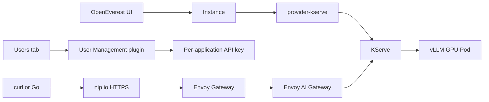

# One-Click LLM Deployment on Kubernetes

## OpenEverest Model-as-a-Service workshop

| Event | Details |
|---|---|
| Format | 45-minute hands-on workshop |
| Host | Native Ubuntu NVIDIA GPU machine |
| Model | Qwen3 0.6B |
| Serving | KServe 0.21 and vLLM |
| Access | Envoy AI Gateway over HTTPS |
| Consumers | One API key per application |

[Add this workshop to your calendar](assets/one-click-llm-deployment/one-click-llm-deployment.ics).

## Workshop result

The workshop starts with a cloneable repository and ends with a consumable model API.

Participants complete these tasks.

- Install the platform with one checked-in script entry point.
- Create a GPU model from an OpenEverest preset.
- Expose it on an HTTPS `nip.io` domain.
- Create separate `chat-app` and `batch-job` API keys.
- Call the OpenAI-compatible API with curl and Go.
- Mount generated credentials from a Kubernetes Secret.
- Prove separate quotas, key rotation, deletion, and metrics.

## UI-first flow

```text
Instances -> Create -> provider-kserve
  -> kserve-qwen-demo-gateway preset
  -> qwen-demo
  -> Connection details
  -> Users
  -> Create API key
  -> chat-app
  -> API key + Base URL + Model
```

The live demo stays in the UI until client verification.

## Architecture



The provider Helm release installs KServe, Envoy Gateway, and Envoy AI Gateway. The User Management plugin adds the Users tab and `InstanceUser` resources.

## Installed releases

| Component | Version |
|---|---:|
| OpenEverest | `2.0.0-dev.4` |
| provider-kserve | `0.5.0` |
| plugin-user-management | `0.2.0` |
| KServe | `0.21.0` |
| Envoy Gateway | `v1.9.2` |
| Envoy AI Gateway / Agent Router | `v1.2.0` |
| Kubernetes | `v1.36.6` |
| Minikube | `v1.39.0` |
| cert-manager | `v1.21.3` |
| kube-prometheus-stack | `92.16.1` |

Agent Router is the current upstream name for the pinned Envoy AI Gateway component. The workshop does not install a second Agent Router controller.

## Clone and prepare

On the GPU host:

```bash
git clone https://github.com/atharvamhaske/kserve-demo.git
cd kserve-demo/docs/open-source-hub-workshop
./scripts/workshop.sh prepare
```

In terminal 2:

```bash
./scripts/workshop.sh tunnel
```

Back in terminal 1:

```bash
./scripts/workshop.sh https-local
./scripts/workshop.sh verify
./scripts/workshop.sh ui
```

The [all-in-one runbook](open-source-hub-workshop/) contains the UI selectors, HTTPS modes, client examples, recovery, and cleanup.

## Model preset

The setup adds `kserve-qwen-demo-gateway`.

The preset selects:

- Qwen3 0.6B.
- One NVIDIA GPU.
- Envoy AI Gateway.
- 300 tokens per user per hour.
- vLLM metrics.
- One replica with a 2048-token context limit.

The provider also installs `kserve-smollm-cpu` and `kserve-qwen-gpu`. Those default presets use ClusterIP and do not demonstrate API keys.

Use the workshop preset for the live demonstration. It keeps the UI story short and guarantees the Gateway, quota, metrics, and one-GPU layout.

Open Start from scratch only as an unsaved teaching view. Use the checked-in `Instance` YAML for CI, GitOps, and automated rehearsal.

The [model creation and parallelism guide](open-source-hub-workshop/model-configuration-guide.md) explains when to use each path and how every parallelism field changes GPU demand.

## One key per consumer

The model owns one System key for compatibility. Applications use generated keys from the Users tab.

Create `chat-app` and `batch-job`. Each receives:

| Field | Purpose |
|---|---|
| API key | Bearer credential for one model consumer. |
| Base URL | HTTPS OpenAI-compatible URL ending in `/v1`. |
| Model | Value for the request `model` field. |
| Secret | Mountable Kubernetes credentials. |

Rotation changes only one consumer. Deletion revokes only one consumer. Metrics keep a stable key ID without exposing the key value.

## OpenAI-compatible API

Curl uses the copied UI values:

```bash
curl --fail-with-body \
  "$OPENAI_BASE_URL/chat/completions" \
  -H "Authorization: Bearer $OPENAI_API_KEY" \
  -H 'Content-Type: application/json' \
  -d "{
    \"model\": \"$OPENAI_MODEL\",
    \"messages\": [
      {\"role\": \"user\", \"content\": \"Explain Kubernetes in one sentence.\"}
    ]
  }"
```

The checked-in Go client uses the official `github.com/openai/openai-go/v3` module:

```bash
cd clients/go
go mod download
go run .
```

## What the demonstration proves

- The host and container runtime can use the NVIDIA GPU.
- Kubernetes can allocate one GPU to a Pod.
- OpenEverest can create the model from a UI preset.
- provider-kserve can reconcile the Instance into KServe resources.
- Envoy Gateway can terminate HTTPS and authenticate API keys.
- Envoy AI Gateway can route by model and meter tokens.
- The plugin can manage one key lifecycle per consumer.
- Curl and Go can use the same OpenAI-compatible contract.
- Valkey can isolate hourly token quotas by API-key ID and model.
- Grafana can attribute Gateway token use without storing the secret key value.

This demonstration does not prove production readiness, performance, high availability, or durable quota storage.

## Live schedule

| Time | Content |
|---|---|
| 0:00-0:05 | Outcome, repository, and architecture |
| 0:05-0:10 | Installed Helm releases and controller roles |
| 0:10-0:18 | Preset-based UI creation and the YAML alternative |
| 0:18-0:23 | Readiness and connection details |
| 0:23-0:29 | Per-application keys in the Users tab |
| 0:29-0:34 | Curl and Go API consumers |
| 0:34-0:38 | Kubernetes Secret mounting |
| 0:38-0:42 | Quota, rotation, and deletion |
| 0:42-0:45 | Grafana and recap |

## Workshop files

- [All-in-one runbook and scripts](open-source-hub-workshop/)
- [Model creation, parallelism, and attendee answers](open-source-hub-workshop/model-configuration-guide.md)
- [Release and API source evidence](open-source-hub-workshop/release-sources.md)
- [Screenshot capture guide](one-click-llm-deployment-screenshot-guide.md)

## Speaker

Atharva Mhaske is a Backend and Infra Engineer at cld9.ai.

Final wording approval rests with the workshop owner.
