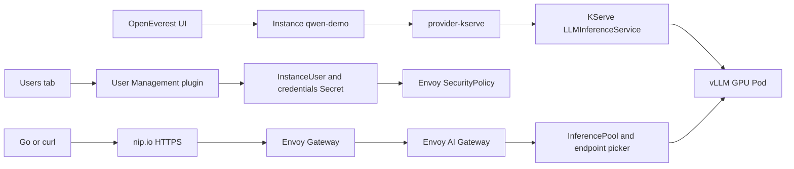

# Open Source Hub UI-first Model-as-a-Service workshop

This module creates one GPU model, one HTTPS endpoint, and one API key per application.

The live story stays in the OpenEverest UI. The checked-in scripts prepare and verify the platform.

## Start here

| Need | Open |
|---|---|
| Run the live workshop | [Fast operator path](#fast-operator-path) |
| Decide between a preset, custom UI, and YAML | [Model creation and parallelism guide](model-configuration-guide.md) |
| Explain tensor, pipeline, data, expert, and replica scaling | [Parallelism starts with the problem](model-configuration-guide.md#parallelism-starts-with-the-problem) |
| Understand checked-in manifests | [Manifest folder guide](manifests/README.md) |
| Operate the scripts | [Script folder guide](scripts/README.md) |
| Call the model API | [Client folder guide](clients/README.md) |
| Verify technical claims | [Release and source evidence](release-sources.md) |

## Presenter decision

Use the `kserve-qwen-demo-gateway` preset card for the live demo.

Open Start from scratch only as an unsaved teaching view. Use `qwen-demo-terminal.yaml` only for an automated rehearsal.

The rule for attendees is simple:

> Use a preset for an approved repeated setup. Use Start from scratch for exploration. Use an `Instance` manifest for automation and review.

## What the audience sees

1. Create `qwen-demo` from an OpenEverest preset.
2. Open its HTTPS connection details.
3. Create `chat-app` and `batch-job` API keys in the Users tab.
4. Call the model with curl and Go.
5. Prove separate quotas, rotation, deletion, and metrics.

The terminal is evidence. The UI is the main story.

## Clone this repository on the GPU host

Use a native Ubuntu NVIDIA GPU host. Do not use WSL for this path.

```bash
git clone https://github.com/atharvamhaske/kserve-demo.git
cd kserve-demo/docs/open-source-hub-workshop
./scripts/workshop.sh help
```

The workshop module is self-contained:

```text
open-source-hub-workshop/
├── README.md
├── model-configuration-guide.md
├── release-sources.md
├── clients/
│   ├── README.md
│   └── go/
│       ├── go.mod
│       └── main.go
├── config/
│   ├── README.md
│   └── workshop.env
├── manifests/
│   ├── README.md
│   ├── application-env.example.yaml
│   ├── demo-valkey.yaml
│   ├── instancepreset-qwen-demo-gateway.yaml
│   ├── instanceuser-chat-app.yaml
│   ├── qwen-demo-terminal.yaml
│   └── selfsigned-clusterissuer.yaml
├── scripts/
│   ├── README.md
│   ├── workshop.sh
│   ├── 00-preflight.sh
│   ├── 10-create-cluster.sh
│   ├── 20-install-platform.sh
│   ├── 30-enable-local-https.sh
│   ├── 31-enable-public-https.sh
│   ├── 40-verify.sh
│   ├── 50-open-ui.sh
│   └── 90-cleanup.sh
└── values/
    ├── README.md
    ├── monitoring.yaml
    └── provider-kserve.yaml
```

## Fast operator path

Use two terminals.

### Terminal 1

Prepare the GPU host and install the platform.

```bash
./scripts/workshop.sh prepare
```

The command stops for the OpenEverest admin password. It does not store that password.

### Terminal 2

Keep the Minikube LoadBalancer tunnel open.

```bash
./scripts/workshop.sh tunnel
```

### Terminal 1 again

Create a local `nip.io` HTTPS endpoint, verify the platform, and open both UIs.

```bash
./scripts/workshop.sh https-local
./scripts/workshop.sh verify
./scripts/workshop.sh ui
```

Open these URLs.

- OpenEverest: `http://localhost:8080`.
- Grafana: `http://localhost:3000`.

For a remote GPU host, run this command on the presenter machine.

```bash
ssh -N \
  -L 8080:localhost:8080 \
  -L 3000:localhost:3000 \
  "$GPU_HOST"
```

Run API clients on the GPU host when the Minikube Gateway address is private.

## Script command map

Use one entry point for every operator action:

| Command | Result |
|---|---|
| `./scripts/workshop.sh preflight` | Verifies native Linux, Docker, NVIDIA GPU, Minikube, Helm, kubectl, and Go. |
| `./scripts/workshop.sh cluster` | Creates Kubernetes 1.36.6 and runs a CUDA vector-add Pod. |
| `./scripts/workshop.sh install` | Installs Gateway API, cert-manager, OpenEverest, monitoring, Valkey, provider-kserve, and the plugin. |
| `./scripts/workshop.sh prepare` | Runs preflight, cluster, and install in order. |
| `./scripts/workshop.sh tunnel` | Runs `minikube tunnel` in terminal 2. |
| `./scripts/workshop.sh https-local` | Creates self-signed HTTPS on a `nip.io` hostname. |
| `./scripts/workshop.sh https-public` | Creates trusted Let's Encrypt HTTPS for a public Gateway. |
| `./scripts/workshop.sh verify` | Checks releases, CRDs, presets, Gateway address, certificate, and the 401 auth gate. |
| `./scripts/workshop.sh ui` | Starts OpenEverest and Grafana port-forwards. |
| `CONFIRM_DELETE=all ./scripts/workshop.sh cleanup` | Deletes the workshop and restores the kernel setting. |

The stage scripts contain every terminal command. The Helm values and Kubernetes manifests are separate, reviewable files.

## What gets installed

| Method | Name | What it adds |
|---|---|---|
| `kubectl apply` | Gateway API CRDs | `GatewayClass`, `Gateway`, `HTTPRoute`, and related APIs. |
| Helm | `cert-manager` | KServe webhook certificates and Gateway TLS certificates. |
| Helm | `everest-core` | OpenEverest UI, API, controllers, plugin support, and core CRDs. |
| Helm | `observability` | Prometheus Operator, Prometheus, and Grafana. |
| Manifest | `demo-valkey` | Demo-only quota counters without persistence. |
| Helm | `provider-kserve` | Provider, KServe, Envoy Gateway, Envoy AI Gateway, Gateway, and dashboards. |
| Helm | `plugin-user-management` | Users tab, plugin API, `InstanceUser` CRD, controller, and credentials Secrets. |
| Manifest | `kserve-qwen-demo-gateway` | Workshop preset for Qwen3 0.6B, GPU, HTTPS Gateway, metrics, and quota. |
| OpenEverest UI | `qwen-demo` | Model workload, route, system key, and connection details. |
| OpenEverest UI | `chat-app`, `batch-job` | Separate credentials and Gateway key Secrets. |

Do not install KServe, Envoy Gateway, or Envoy AI Gateway as separate releases. The provider release installs its pinned subcharts.

## Component flow



The matching ASCII request path is:

```text
Go or curl
  -> https://<gateway-ip-with-dashes>.nip.io/v1
  -> Envoy Gateway: TLS and API-key authentication
  -> Envoy AI Gateway: model routing, token metering, quota identity
  -> KServe InferencePool and endpoint picker
  -> vLLM Pod
  -> NVIDIA GPU
```

## Envoy AI Gateway, Agent Router, and agentgateway

provider-kserve `0.5.0` installs Envoy AI Gateway `v1.2.0` when the checked-in values enable it.

The current upstream project is called Agent Router. The pinned chart and OpenEverest UI still use the Envoy AI Gateway name.

Do not install another Agent Router release. That duplicates the controller already installed by provider-kserve.

KServe also supports a different project named `agentgateway`. provider-kserve `0.5.0` does not install or use it.

The KServe endpoint picker is not Agent Router. It selects a healthy vLLM endpoint after Gateway authorization.

## Release pins

| Component | Version |
|---|---:|
| OpenEverest | `2.0.0-dev.4` Developer Preview |
| provider-kserve | `0.5.0` |
| plugin-user-management | `0.2.0` |
| KServe | `0.21.0` |
| vLLM | `0.26.0` |
| Envoy Gateway | `v1.9.2` |
| Envoy AI Gateway / Agent Router | `v1.2.0` |
| Gateway API | `v1.6` |
| Kubernetes | `v1.36.6` |
| Minikube | `v1.39.0` |
| cert-manager | `v1.21.3` |
| Valkey | `9.1.3-alpine` |
| kube-prometheus-stack | `92.16.1` |
| Prometheus | `v3.15.1` |
| Grafana | `13.3.0` |
| OpenAI Go client | `v3.91.0` |

Kubernetes 1.37 is outside the provider's declared range. Pin Kubernetes 1.36.6.

See [release sources](release-sources.md) for primary-source evidence.

## Plugins and presets

### Installed plugin

This workshop installs one OpenEverest plugin:

| Plugin | UI location | Purpose |
|---|---|---|
| User Management `0.2.0` | Model details, then Users | Creates, shows, rotates, and deletes one API key per model consumer. |

Verify it from the terminal:

```bash
kubectl get plugins.extensions.openeverest.io plugin-user-management
```

### Installed presets

provider-kserve installs two defaults. The setup script adds one workshop preset.

| Preset card | Model | Compute | Access | Use |
|---|---|---|---|---|
| `kserve-smollm-cpu` | SmolLM2 135M Instruct | CPU | ClusterIP | Fast controller smoke test. |
| `kserve-qwen-gpu` | Qwen3 4B | One GPU | ClusterIP | Default provider GPU example. |
| `kserve-qwen-demo-gateway` | Qwen3 0.6B | One GPU | Envoy AI Gateway | Main HTTPS and API-key workshop. |

List and inspect them:

```bash
kubectl get instancepreset
kubectl get instancepreset kserve-smollm-cpu -o yaml
kubectl get instancepreset kserve-qwen-gpu -o yaml
kubectl get instancepreset kserve-qwen-demo-gateway -o yaml
```

The two provider defaults do not enable Envoy AI Gateway. They cannot demonstrate per-application keys.

OpenEverest does not store a `presetRef` in an Instance. The UI resolves a preset and submits a complete Instance spec. The annotation records which preset supplied the spec.

For the live demo, select `kserve-qwen-demo-gateway`. Open the manual form only to explain fields, then close it without creating a second model.

Use [qwen-demo-terminal.yaml](manifests/qwen-demo-terminal.yaml) for CI, GitOps, or automated rehearsal.

Read the [model creation and parallelism guide](model-configuration-guide.md) for the full decision table and attendee answers.

## HTTPS modes

### Local Minikube mode

`./scripts/workshop.sh https-local` uses the Gateway IPv4 address to create this hostname:

```text
https://<gateway-ip-with-dashes>.nip.io/v1
```

It creates a self-signed certificate and saves it here:

```text
${XDG_STATE_HOME:-$HOME/.local/state}/openeverest-kserve-workshop/gateway.crt
```

The script verifies that HTTPS without a key returns `401`.

### Public trusted mode

Use this only when the Gateway has a public IPv4 address and ports 80 and 443 are reachable from the internet.

Rehearse with the Let's Encrypt staging server:

```bash
export PUBLIC_GATEWAY_CONFIRMED=yes
export ACME_EMAIL=presenter@example.com
export ACME_SERVER=https://acme-staging-v02.api.letsencrypt.org/directory
./scripts/workshop.sh https-public
```

Use the production server for the final trusted certificate:

```bash
export PUBLIC_GATEWAY_CONFIRMED=yes
export ACME_EMAIL=presenter@example.com
unset ACME_SERVER
./scripts/workshop.sh https-public
```

A private Minikube address cannot pass public HTTP-01 validation. Use local mode or a cluster with a public LoadBalancer.

## Minikube alternatives

Keep Minikube as the disposable local default.

| Option | Best fit | Required change |
|---|---|---|
| MicroK8s | Ubuntu host with packaged GPU support. | Pin a supported channel and configure the NVIDIA runtime class. |
| K3s | Lightweight host installation. | Pin Kubernetes 1.30 through 1.36 and make NVIDIA the generated Pod runtime. |
| kubeadm | Production-like local cluster. | Add networking, LoadBalancer support, and the NVIDIA device plugin. |
| GKE Standard | Public trusted HTTPS demo. | Create a GPU node pool and use the cloud LoadBalancer. |

Do not use kind for this workshop. The project does not document a supported NVIDIA GPU path.

k3d needs a custom CUDA-capable K3s image and extra runtime configuration. It is not simpler here.

## Live UI path

## 1. Create the model from the workshop preset

Open OpenEverest and select Instances, then Create.

If the provider drawer appears, select `provider-kserve`.

The first wizard step is Basic Info. Its heading is Create an instance.

Select the preset card:

```text
kserve-qwen-demo-gateway
```

Set:

| Field | Value |
|---|---|
| Namespace | `default` |
| Display name | `qwen-demo` |
| Topology | `llm`, locked by the preset |

Select Create.

The preset already selects:

- Qwen3 0.6B.
- One GPU.
- Two CPUs and 16 GiB memory request.
- One replica.
- 2048 context tokens.
- One concurrent sequence.
- 0.2 GPU memory use.
- Envoy AI Gateway.
- 300 tokens per user per hour.
- vLLM Prometheus metrics.

Selecting a preset disables Configure more options. This is intentional for the short live path.

## 2. Manual UI path

Use this as an alternative creation method or as an unsaved teaching view.

Select Start from scratch, then Configure more options.

Set the top-level fields:

| Field | Value |
|---|---|
| Namespace | `default` |
| Display name | `qwen-demo` |
| Topology | `llm` |

Set the model form:

| Section | Field | Value |
|---|---|---|
| Basic Information | Model | `Qwen3 0.6B` |
| Basic Information | Image pull secret | Empty |
| Basic Information | Served Model Name | `qwen3-0.6b` |
| Basic Information | vLLM Runtime Version | Default |
| Scaling & Parallelism | Replicas | `1` |
| Scaling & Parallelism | Autoscaling | Off |
| Scaling & Parallelism | Tensor parallel size | `1` |
| Scaling & Parallelism | Pipeline parallel size | `1` |
| Scaling & Parallelism | Data parallel size | `1` |
| Scaling & Parallelism | Multi-node workers | Off |
| Runtime | Compute Profile | `GPU` |
| Runtime | GPUs per pod | `1` |
| Runtime | CPU | `2` |
| Runtime | Memory | `16` GiB |
| Engine Tuning | Max context length | `2048` |
| Engine Tuning | Max concurrent sequences | `1` |
| Engine Tuning | GPU memory utilization | `0.2` |
| LoRA Adapters | LoRA deployment | `Base model only` |
| Routing | External access | `Envoy AI Gateway` |
| Routing | Tokens per User per Hour | `300` |
| Disaggregated Serving | Enable Prefill/Decode Disaggregation | Off |
| Observability | vLLM Prometheus metrics | On |
| Observability | Distributed tracing | Off |
| Scheduling | Pod scheduling policy | Off |
| Advanced | LLMInferenceServiceConfig | Empty |

If this method replaces the preset path, review the form and select Create. During the recommended demo, close this form without submitting it.

Keep every parallel size at `1` for this model. It fits on one GPU, so distributed inference adds complexity without solving a capacity problem.

For larger models, read [Parallelism starts with the problem](model-configuration-guide.md#parallelism-starts-with-the-problem) before changing these fields.

## 3. Terminal model alternative

The live workshop uses the UI. For automated rehearsal, apply the same complete Instance spec:

```bash
kubectl apply -f manifests/qwen-demo-terminal.yaml
```

Do not apply this manifest after the UI already created `qwen-demo`.

## 4. Prove model readiness

```bash
kubectl -n default get instance,llminferenceservice,pod,svc,podmonitor -w
```

After the model Pod appears, stop the watch and run:

```bash
MODEL_SELECTOR='app.kubernetes.io/name=qwen-demo,kserve.io/component=workload'
MODEL_POD=$(kubectl -n default get pod \
  -l "$MODEL_SELECTOR" \
  -o jsonpath='{.items[0].metadata.name}')
kubectl -n default wait \
  --for=condition=Ready pod/"$MODEL_POD" \
  --timeout=30m
kubectl -n default get instance qwen-demo -o wide
```

Gate: The Instance and vLLM Pod are ready.

## 5. Show model connection details

Open `qwen-demo`, then Connection details.

| Field | Meaning |
|---|---|
| Base URL | OpenAI-compatible URL ending in `/v1`. |
| API key | Model-owned System key. Keep it only for migration or administration. |
| Model | Value for the OpenAI request `model` field. |

Do not give the System key to every application.

## 6. Create API keys in the Users tab

Open the `qwen-demo` Users tab.

The tab heading is API keys. The model-owned key appears as a System user.

Select Create API key and set:

| Field | Value |
|---|---|
| Name | `chat-app` |
| Role | `invoke`, preselected |

Select Create.

The success dialog shows:

- Name
- API key
- Base URL
- Model

Copy the API key, Base URL, and Model. The key is not view-once. Show credentials can retrieve it later.

Repeat with Name `batch-job`.

Wait until both rows show Ready.

## 7. Load copied client values

For local HTTPS, load the generated Gateway state first:

```bash
GATEWAY_STATE=${XDG_STATE_HOME:-$HOME/.local/state}/openeverest-kserve-workshop/gateway.env
set -a
source "$GATEWAY_STATE"
set +a
if [ -n "${GATEWAY_CERT:-}" ]; then
  export CURL_CA_BUNDLE="$GATEWAY_CERT"
  export SSL_CERT_FILE="$GATEWAY_CERT"
fi
```

Load the UI values without printing the keys:

```bash
read -rsp 'Paste chat-app API key: ' OPENAI_API_KEY
printf '\n'
read -rp 'Paste Base URL: ' OPENAI_BASE_URL
read -rp 'Paste Model: ' OPENAI_MODEL
read -rsp 'Paste batch-job API key: ' BATCH_API_KEY
printf '\n'
export OPENAI_API_KEY OPENAI_BASE_URL OPENAI_MODEL BATCH_API_KEY
```

## 8. Call the model with curl

No key returns `401`:

```bash
curl --silent --output /dev/null --write-out '%{http_code}\n' \
  "$OPENAI_BASE_URL/models"
```

Call the model with `chat-app`:

```bash
curl --fail-with-body \
  "$OPENAI_BASE_URL/chat/completions" \
  -H "Authorization: Bearer $OPENAI_API_KEY" \
  -H 'Content-Type: application/json' \
  -d "{
    \"model\": \"$OPENAI_MODEL\",
    \"messages\": [
      {
        \"role\": \"user\",
        \"content\": \"Explain this request path in three short steps.\"
      }
    ],
    \"chat_template_kwargs\": {\"enable_thinking\": false},
    \"max_tokens\": 96,
    \"temperature\": 0
  }" | jq
```

## 9. Call the model from Go

The checked-in client uses `github.com/openai/openai-go/v3`.

```bash
cd clients/go
go mod download
go run .
cd ../..
```

It reads:

- `OPENAI_API_KEY`
- `OPENAI_BASE_URL`
- `OPENAI_MODEL`
- `SSL_CERT_FILE` for local self-signed TLS

## 10. Mount credentials in an application

Find the generated credentials Secret:

```bash
CHAT_USER=$(kubectl -n default get instanceuser \
  -l plugin-user-management.plugins.openeverest.io/instance=qwen-demo \
  -o jsonpath='{range .items[?(@.spec.username=="chat-app")]}{.metadata.name}{"\n"}{end}')
CHAT_SECRET=$(kubectl -n default get instanceuser "$CHAT_USER" \
  -o jsonpath='{.status.credentialsSecret}')
printf 'InstanceUser=%s\nCredentials Secret=%s\n' \
  "$CHAT_USER" "$CHAT_SECRET"
```

Use [application-env.example.yaml](manifests/application-env.example.yaml) in a Deployment. Replace `CHAT_CREDENTIALS_SECRET` with the printed Secret name.

The Secret keys are:

| Key | Application environment variable |
|---|---|
| `password` | `OPENAI_API_KEY` |
| `uri` | `OPENAI_BASE_URL` |
| `model` | `OPENAI_MODEL` |

For GitOps, use [instanceuser-chat-app.yaml](manifests/instanceuser-chat-app.yaml).

## 11. Prove separate quotas

The model preset sets 300 tokens per user per hour. Valkey keeps one bucket per API-key ID and model.

Use `chat-app` until it reaches `429`:

```bash
status=000
for attempt in $(seq 1 20); do
  status=$(curl --silent \
    --output /tmp/chat-app-quota-response.json \
    --write-out '%{http_code}' \
    "$OPENAI_BASE_URL/chat/completions" \
    -H "Authorization: Bearer $OPENAI_API_KEY" \
    -H 'Content-Type: application/json' \
    -d "{
      \"model\": \"$OPENAI_MODEL\",
      \"messages\": [
        {
          \"role\": \"user\",
          \"content\": \"Write one hundred words about Kubernetes controllers.\"
        }
      ],
      \"chat_template_kwargs\": {\"enable_thinking\": false},
      \"max_tokens\": 128,
      \"temperature\": 0
    }")
  printf 'chat-app attempt %s: HTTP %s\n' "$attempt" "$status"
  if [ "$status" = 429 ]; then
    break
  fi
done
test "$status" = 429
```

Call the same model with `batch-job`:

```bash
curl --fail-with-body \
  "$OPENAI_BASE_URL/models" \
  -H "Authorization: Bearer $BATCH_API_KEY" | jq
```

Gate: `chat-app` receives `429`. `batch-job` still works.

## 12. Show per-key metrics

Find the stable `chat-app` key ID:

```bash
CHAT_KEY_ID=$(kubectl -n default get secret \
  -l 'openeverest.io/ai-gateway-key=true,openeverest.io/ai-gateway-key-owner-name=chat-app' \
  -o jsonpath='{.items[0].metadata.annotations.openeverest\.io/ai-gateway-key-id}')
printf 'chat-app key ID: %s\n' "$CHAT_KEY_ID"
```

Open Grafana, then Dashboards. Show the vLLM and Envoy AI Gateway dashboards.

In Explore, run:

```promql
sum by (openeverest_key_id, gen_ai_token_type) (
  increase(gen_ai_client_token_usage_sum{gen_ai_token_type="total"}[1h])
)
```

Match `CHAT_KEY_ID` to `openeverest_key_id`.

## 13. Rotate and delete keys

In the Users tab, open the `chat-app` Actions menu. Select Rotate API key.

Keep the old value and paste the new value:

```bash
OLD_CHAT_API_KEY=$OPENAI_API_KEY
read -rsp 'Paste the new chat-app API key: ' OPENAI_API_KEY
printf '\n'
export OPENAI_API_KEY
```

Test both keys:

```bash
curl --silent --output /dev/null --write-out '%{http_code}\n' \
  "$OPENAI_BASE_URL/models" \
  -H "Authorization: Bearer $OLD_CHAT_API_KEY"
curl --fail-with-body \
  "$OPENAI_BASE_URL/models" \
  -H "Authorization: Bearer $OPENAI_API_KEY" | jq
unset OLD_CHAT_API_KEY
```

The old key returns `401`. The new key succeeds.

Delete `batch-job` in the UI, then test it:

```bash
curl --silent --output /dev/null --write-out '%{http_code}\n' \
  "$OPENAI_BASE_URL/models" \
  -H "Authorization: Bearer $BATCH_API_KEY"
```

The deleted key returns `401`. `chat-app` remains valid.

## 14. Show generated resources

```bash
kubectl -n default get \
  instance,instanceuser,llminferenceservice,pod,svc,podmonitor
kubectl -n everest-system get gateway,certificate
kubectl -n default get secret \
  -l openeverest.io/ai-gateway-key=true \
  -o custom-columns='NAME:.metadata.name,OWNER:.metadata.labels.openeverest\.io/ai-gateway-key-owner-name,KEY-ID:.metadata.annotations.openeverest\.io/ai-gateway-key-id'
```

Do not print Secret data on screen.

## 45-minute speaker timeline

| Time | Show | Point |
|---|---|---|
| 0:00-0:05 | Outcome, folder tree, component flow | One repository contains the operator and consumer paths. |
| 0:05-0:10 | Helm release table | provider-kserve installs KServe and both Envoy components. |
| 0:10-0:18 | Preset creation and alternatives | Use the preset live, show the unsaved custom form, and name YAML as the automation path. |
| 0:18-0:23 | Readiness and connection details | The provider creates the serving and connection resources. |
| 0:23-0:29 | Users tab | Each application gets its own generated key and Secret. |
| 0:29-0:34 | curl and Go | Both clients use Base URL, API key, and Model. |
| 0:34-0:38 | Secret mounting | Applications consume credentials without putting keys in manifests. |
| 0:38-0:42 | Quota, rotation, deletion | Consumer lifecycles are independent. |
| 0:42-0:45 | Grafana | Token usage is attributable by stable key ID. |

## Recovery

Check the model:

```bash
kubectl -n default get instance qwen-demo -o yaml
kubectl -n default describe pod "$MODEL_POD"
kubectl -n default logs "$MODEL_POD" -c main --tail=200
```

Check Gateway and TLS:

```bash
kubectl -n everest-system get gateway,certificate
kubectl -n everest-system get certificaterequest,challenge,order
```

Check API-key users:

```bash
kubectl -n default get instanceuser -o wide
kubectl -n everest-system logs \
  deployment/plugin-user-management --tail=200
```

Check quota storage:

```bash
kubectl -n everest-system get deployment,service demo-valkey
kubectl -n everest-system logs deployment/demo-valkey --tail=100
kubectl get backendtrafficpolicy -A
```

## Cleanup

Delete `qwen-demo` in the UI first. Confirm that its API-key users disappear.

Stop the tunnel in terminal 2 with Ctrl-C.

Then run:

```bash
CONFIRM_DELETE=all ./scripts/workshop.sh cleanup
```

The cleanup script deletes the cluster and restores `net.core.bpf_jit_harden`.

## Related documents

- [Model creation and parallelism guide](model-configuration-guide.md)
- [Manifest folder guide](manifests/README.md)
- [Script folder guide](scripts/README.md)
- [Client folder guide](clients/README.md)
- [Release and API source evidence](release-sources.md)
- [Screenshot capture guide](../one-click-llm-deployment-screenshot-guide.md)
- [Public workshop page](../one-click-llm-deployment-workshop.md)

Final wording approval rests with the workshop owner.
